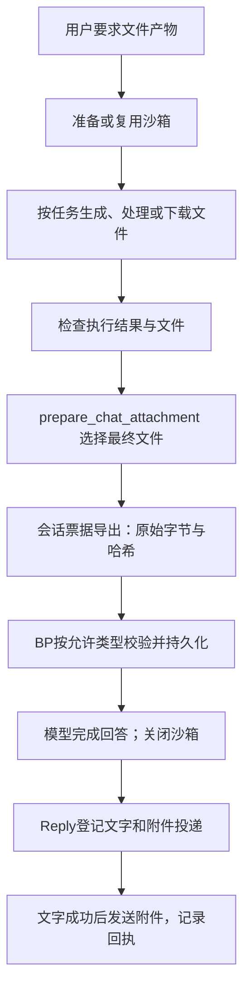

# 沙箱文件附件回复

本迭代将[沙箱绘图与聊天图片回复](技术方案-沙箱绘图与聊天图片回复.md)扩展为通用的单附件回复，图片与图表属于产物类型之一。

## 改造点

1. 内置工具统一为 `prepare_chat_attachment({path})`，每轮只选择一个沙箱文件，成功执行 Reply 才发送。
2. 沙箱新增独立 `io.bubblepilot/file-export` v1 能力及会话内单次票据导出；原 PNG 导出协议继续服务旧授权。
3. BP 校验类型、文件名、大小和结构后保存原始字节、SHA-256、MIME、文件名及可选图片尺寸。
4. 工作流“附件回复”增加允许文件类型，旧配置缺省仅 PNG。仅对明确勾选的类型开放。
5. 发送真实文件名/MIME，审计支持图片预览及其他文件下载；沿用敏感验证、幂等、未知结果不重发、到期清理。
6. 0074 迁移补齐已有 PNG 元数据、拓展文件字段约束；测试和运维备份规则同步。

## 范围与限制

| 类型 | 展示/处理 | 上限 |
| --- | --- | --- |
| PNG / JPEG（含 .jpg） | 原图发送；校验实际格式、完整解码及尺寸 | 8 MiB、单边8192、1600万像素；PNG拒绝动画 |
| PDF | 文件附件；校验文件头和结束标记，不在宿主渲染 | 20 MiB |
| XLSX | 文件附件；检查ZIP/OOXML结构、CRC，拒绝宏类型；两项核心XML分别最多1 MiB，不执行宏 | 20 MiB |
| CSV / TXT / Markdown | UTF-8文本附件，拒绝二进制控制字符 | 20 MiB |
| ZIP | 文件附件；逐项流式检查，不展开到宿主、不递归解包 | 20 MiB、200项、展开总量50 MiB；拒绝加密、符号链接、越界及重复路径 |

这些检查不是杀毒、PDF主动内容清除或文件业务正确性证明。下载按附件返回、启用nosniff，不在管理台直接渲染文档或执行脚本。SVG先转PNG；不支持HTML、可执行文件、宏表格等其他顶层格式。文件名从沙箱路径末段取得，禁止控制/双向覆盖字符和路径分隔符；最多160字符、240 UTF-8字节。模型不提供宿主路径、下载URL或自报MIME。

普通入站消息、具备工具能力的文本回答模式可用；调度触发与引用式附件发送继续不支持。不自动扩大历史读取、联网、插件或聊天范围；附件导入与回复同时开启时绑定同一沙箱。

## 工作流与模型交互

复杂源码优先 `write_file` 后短 `run_command`；简单文本可直接写文件，已有处理结果或授权下载不必重写。看图仅可选，不把文件读到模型里作为发送前提。不够额度时解释未完成部分；不额外增加工具次数或时间预算。一次准备失败立即清除旧选择，不能错误发送上一版产物。

工具仅声明本节点允许的类型。选定类型由代码在导出前后核对，服务端MIME由实际检查与扩展名映射决定。对文件来源的权限、运行归属和撤权继续在导出/提交时复核。保持模型收到的错误为受控代码，不暴露凭据、宿主目录或文件内容。

## 兼容与数据

为保持已发布工作流、历史连线和管理端书签可读，`imageReply`、`generatedImage`、`generated-images` API及现有表/投递字段保留内部标识，语义扩展为受控附件；界面统一显示“附件回复”和“回复附件”。不原地改写已有工作流版本。

`imageReply.allowedTypes`可选，缺省等价`["png"]`；显式配置至少一种且不能重复。服务能力列表新增 `fileTypes`，缺少新版文件导出授权时只允许PNG。存储表新增 `filename`、`mime_type`、`file_type`；旧行回填`chart.png`、`image/png`、`png`，原图路径和投递记录不变。图片宽高仍强校验，其他附件宽高为空。同一运行、内容哈希、名称和类型复用产物。

原图文件仍可读，新增文件使用随机`.file`存储键。数据库及挂载目录仍是权威来源。保留现有目录/环境变量避免漏挂载；生成产物共享容量和保留期。新版本会写入旧版不能处理的非图片元数据，不能仅切回旧镜像继续执行；升级前按运维手册备份并核验全部保留产物。

## 验收

使用虚构资料覆盖PNG/JPEG、PDF、XLSX、CSV、TXT、Markdown、ZIP；验证文件哈希、名称、MIME和聊天投递命令一致，文件无需回灌模型。两种AI协议、严格/兼容及Provider降级维持正确工具配对。旧PNG配置不能导出其他类型，新能力不改变普通工具哈希或自动扩大节点授权。

覆盖跨会话票据、重复票据、符号链接/FIFO/越界、撤权、超限、UTF-8错误、伪装格式、ZIP限制、过期、未知结果、单项重试和重复发送保护。独立PostgreSQL验证0073→0074旧数据回填、持久化与重启可读。真实模型及iMessage附件效果单独验收，不将模拟网关通过视为真实聊天已验证。
