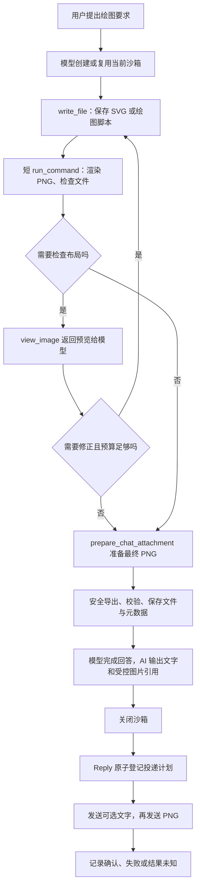

# 技术方案：沙箱绘图与聊天图片回复

本文保留PNG初版设计基线。后续范围、工具和文件类型以[沙箱文件附件回复](技术方案-沙箱文件附件回复.md)为准，旧配置仍保持PNG-only。

> 状态：2026-11-18 已实现并通过本地验证，尚未发布。关键技术与真实本地 OpenSandbox 代理导出验证见[实验记录](experiments/svg-chat-image/README.md)，完整验收记录见[验收与演练](验收与演练.md)。真实模型与 iMessage 接收质量仍待部署后验收。下文保留设计依据，实际接口以同步的机器合同为准。

## 极简改造清单

- [x] **沙箱绘图**：预装固定版本 resvg 和中文字体，提供受限渲染入口；优先 `write_file` 保存 SVG/绘图脚本，再以短 `run_command` 转 PNG 和基础检查。
- [x] **准备发送**：新增 BP 内置 `prepare_chat_attachment({path})`，通过受认证二进制通道导出当前沙箱 PNG，不直接发消息。
- [x] **产物保存**：增加生成图片元数据、持久化文件、运行归属、清理与容量控制；沙箱关闭后仍可发送。
- [x] **工作流回复**：AI 输出受控图片引用，Reply 支持纯图片、文字加图片；发送计划持久化，失败不重发已成功部分。
- [x] **配置与提示词**：AI 节点显式启用图片回复并绑定沙箱；视觉检查可选，不增加默认工具次数和模型轮数。
- [x] **审计与验收**：记录渲染、导出、发送各阶段；新增产物预览与权限校验，补齐数据库、协议、故障恢复和真实网关验收。

## 1. 目标与首版边界

用户向兰博提出绘图要求后，模型在当前运行的沙箱中生成 SVG、转换为 PNG，最终由现有回复节点发送到当前聊天。例如：将统计结果绘制为中文图表、生成流程图或说明卡片。

| 项目 | 首版规则 |
| --- | --- |
| 触发方式 | 普通入站消息触发；空闲主动交流、定时任务暂不提供图片准备工具 |
| 输出 | 一次 Agent 运行最多选定一张 PNG，可带说明文字，也可仅发图片 |
| 绘图路径 | 优先原生 SVG → PNG；导出工具接收沙箱内有效 PNG，不尝试证明它一定由 SVG 生成 |
| 发送目标 | 程序绑定的当前聊天；模型不能指定聊天、网关、URL 或接收人 |
| 看图 | 可选，复用 `view_image`；未看图也可导出，但不得声称已视觉检查 |
| 不包含 | SVG 源文件回传、PDF/压缩包等通用文件发送、多图批量发送、跨聊天发送、自动加入表情库 |
| 现有功能 | 保留附件导入、工具图片输入、表情库和文字回复；默认关闭新图片回复能力 |

首版不支持“引用原消息发送生成图片”。现有图片网关合同没有对应参数；启用图片回复且下游 Reply 配置引用发送时，发布校验明确报出不兼容节点，不静默丢弃引用设置。

## 2. 已验证事实与实现缺口

| 已验证 | 对设计的影响 |
| --- | --- |
| 1 CPU / 512 MiB 的 amd64 容器中，中文 SVG 正常渲染；1200×760 约 0.16 秒，2400×1520 约 0.41 秒 | 无需浏览器，运行时预装渲染器和字体即可；这些不是端到端耗时保证 |
| 约 3 MB PNG 可通过二进制 HTTP 完整导出，哈希一致 | 不提高命令 stdout 上限，不把原图 Base64 放进模型文本 |
| 源文件准备后变化不影响导出快照；沙箱删除后 BP 侧文件仍可使用 | 必须在 Agent 关闭沙箱前完成导出和持久化 |
| 正式 `sendAttachment` 适配器在本地假网关中发送字段和字节正确 | 复用网关接口，新增的是产物与投递编排 |
| `foreignObject` 渲染为空白，resvg 会加载相对路径图片 | 明确 SVG 支持范围和资源策略，不能以退出码 0 代替完整性判断 |

本轮预研没有通过真实 OpenSandbox server proxy、正式 MCP 导出接口或 iMessage；相关集成仍是正式开发的验收项。现有 `view_image` 会缩放或转 JPEG，只用于模型预览，不能当作最终 PNG 的导出通道。

当前 `agent-runner` 在返回 AI 结果前关闭插件会话；Reply 要求非空文字；表情发送依赖 `meme_id`。这些是必须调整的生命周期和合同，不应通过保留沙箱或伪造表情资产绕开。

## 3. 总体链路与调用预算



| 正常路径 | 工具调用次数 | 按每轮一个工具估算的模型请求数 |
| --- | --- | --- |
| 创建 → 写文件 → 渲染 → 准备发送 → 回答 | 4 | 5 |
| 上述路径增加一次看图 | 5 | 6 |
| 看图后再写文件、渲染并看图一次 | 8 | 9 |

已有沙箱可省创建调用。最终 Reply 的网络发送不消耗 Agent 工具调用次数，受自己的发送时限和重试规则控制。

代码默认预算仍为 10 次工具调用、64,000 工具输出字符、90 秒累计工具执行时间，模型最多 `maxToolCalls + 2` 轮，最后两轮用于收尾。搜索、附件导入、绘图、预览、导出共享预算，工具批量调用仍逐个计数；模型生成时间不计入工具累计时长。

不为绘图另开隐藏预算、不强制看图、不自动增大轮数。提示词要求为准备发送至少留一次调用；复杂任务在开始绘图前核对剩余时间和次数。额度不足时解释未完成部分，不能把保存路径当作已发送图片。正式上线前核对实际数据库配置，不把代码默认值当作环境当前值。

## 4. 沙箱运行时与渲染

### 4.1 镜像与命令

在现有 Python 镜像内固定安装 resvg、Noto Sans CJK SC，保留许可证与校验哈希，声明新增绘图能力。实施时确认依赖安全和平台支持，禁止运行中临时下载渲染器、安装字体或改变镜像。

新增运行时命令 `bp-render-svg`，固定使用镜像依赖。默认引导模型先通过已授权的 `write_file` 保存原生 SVG 或 Python 绘图脚本，再用短命令执行并检查结果，避免长源码同时嵌套于 Shell、Python 和 MCP JSON 字符串中。

```text
write_file：保存 /workspace/chart.svg 或 /workspace/draw.py
  └─ run_command：bp-render-svg /workspace/chart.svg /workspace/chart.png
       或 python /workspace/draw.py
       └─ 输出简短结果：成功、路径、尺寸、大小
```

写文件和执行分别计数。`write_file`、`run_command` 等可直接适配的 MCP 工具按实际字段声明，移除额外 `arguments_json` 字符串包装；复杂 Schema 保留显式封装。普通工具调用仍是 JSON，不保证模型不会生成错误参数；不自动修补并执行不合法参数。未授权 `write_file` 时仅对可可靠编码的简单任务使用紧凑命令，否则说明限制，不自动扩大权限。

`run_command.command` 当前最多 32,768 字符，文件写入也受自身 Schema 和现有预算限制；不承诺任意复杂图都能塞入一个参数。命令标准输出仍限 1 MiB，只输出元数据。

### 4.2 渲染规则

- 支持基本形状、路径、原生文字、渐变、裁剪和受限滤镜；中文指定镜像字体，长文本用 `tspan` 或明确分行。
- 拒绝脚本、事件属性、`foreignObject`、DTD/外部实体；首版不支持外部图片、外部 CSS/字体或嵌入式数据图片，`url(#id)` 等本 SVG 内引用可用。
- 解析后按支持子集检查，不以正则代替完整 XML/属性处理；资源加载必须被限制，不能仅依赖“某些 URL 在测试中没加载”。不支持的内容返回明确原因，不能悄悄输出缺字或空白图。
- 渲染在沙箱内执行，不引入宿主浏览器或宿主 SVG 渲染；运行时 helper 不是隔离任意沙箱命令的安全边界，最终导出必须独立验证 PNG。
- 初始约束：SVG 输入最多 1 MiB、输出单边最多 8192、总像素最多 1600 万；复杂度设上限，渲染时间取本轮剩余预算、命令时限与 helper 10 秒上限的最小值。超时终止子进程并删除未完成输出。
- 导出只接收完整静态 PNG；动画 PNG 拒绝，不擅自取首帧。保留原尺寸和透明度，不用预览图替代最终文件。

## 5. 配置与授权

### 5.1 AI 节点配置

新增 `imageReply` 配置，默认 `enabled=false`：

```json
{
  "imageReply": {
    "enabled": true,
    "pluginId": "<已安装的沙箱插件 ID>",
    "server": "<已授权的服务名称>"
  }
}
```

配置项放在 AI 节点的沙箱能力区域，名称为“生成图片回复”。一个合格目标可预选，多个必须由管理员选择，模型不选择服务。

允许独立开启图片回复，不要求启用聊天附件导入或模型视觉输入。若同节点同时开启附件导入，首版要求两项绑定同一个沙箱服务，以便共享当前会话；发布校验指出冲突，不创建两个隐式沙箱。

合格目标必须已授权 `prepare_sandbox`、`run_command`，并声明新版图片导出协议；`view_image` 为可选授权。新增能力不能因普通工具定义自动同步而自动启用。可沿用 MCP `experimental` 能力发现机制，将图片导出协议版本独立持久化、校验并纳入工作流绑定，不能只凭工具名称推断支持。

工作流管理沿用当前登录与审计规则，不重新增加敏感密码要求。插件连接和工具授权保留现有权限要求。开关说明应明确“允许将本次沙箱 PNG 发送到当前聊天”。

### 5.2 运行时约束

- 工具仅在允许工具调用的文本回答模式、普通入站消息、已启用图片回复且目标可用时注册；不在 JSON/结构化回答或调度任务中隐式开放。
- 不因绘图要求扩大聊天历史、附件导入或联网权限；原数据访问授权照常执行。
- 准备工具执行时及提交 AI 输出时校验会话、工作流和能力归属；取消或撤权不得提交新的产物。已合法读取的内容仍按读取时快照处理，不强制重新检索历史。
- 选定待发图片属于运行结果，不因仅创建 PNG 文件就自动发送；必须经过准备工具和正常成功的 Reply 路径。

## 6. `prepare_chat_attachment` 工具合同

这是 **BP 内置工具**，调用已绑定沙箱的二进制导出能力；不是要求任意 MCP 服务自行向聊天发送文件。

```json
{
  "name": "prepare_chat_attachment",
  "description": "准备将本次沙箱中的一张 PNG 作为最终回复发送到当前聊天。仅准备，不立即发送；成功后由回复节点发送。应在绘图和可选看图修改完成后调用。",
  "parameters": {
    "type": "object",
    "properties": {
      "path": {
        "type": "string",
        "description": "本次沙箱 /workspace 下 PNG 的绝对路径，例如 /workspace/chart.png。"
      }
    },
    "required": ["path"],
    "additionalProperties": false
  }
}
```

没有可选参数，严格/兼容模式都不引入 null 歧义。目标聊天、执行 ID、沙箱实例、存储路径、票据和文件名均由程序绑定或生成，不交给模型传参。

成功返回示例：

```json
{
  "status": "prepared",
  "image_ref": "generated-image-1",
  "mime_type": "image/png",
  "width": 2400,
  "height": 1520,
  "bytes": 461259,
  "delivery": "pending_reply_node"
}
```

`image_ref` 只在当前运行内有效，由工具会话写入可信 AI 输出；不从模型最终文字提取、不接受模型伪造引用。不返回原图字节、下载 URL、宿主路径或发送凭据。

重复准备规则：

1. 每次调用都计入预算并重新核对来源。路径不是缓存键，修改同一路径后应取得新的字节快照。
2. 同一运行内相同哈希复用现有产物；不同运行不凭哈希共享访问权。
3. 每次新的准备尝试先清除当前待发选择；成功后替换为新产物，失败则保持无选择，防止把旧草稿当作新图发送。
4. 已绑定投递计划的产物不可被替换，重试使用持久化计划。未绑定的旧草稿进入清理。
5. 模型正常结束且工具会话仍有有效选择时，将该选择提交为 AI 节点输出；AI 最终失败、取消或输出校验失败时不发送。

统一错误结构包含 `code`、可读 `message`、`retryable`、可行 `guidance`。至少区分能力关闭、目标不可用、沙箱未创建、会话失效、路径被拒、文件不存在、PNG 无效/动画、大小/像素超限、导出超时、哈希不符、磁盘容量不足、预算耗尽。错误必须回传模型，不能只记录服务端日志。

## 7. 二进制导出与存储安全

沿用已有附件导入的控制面模式，增加方向相反的私有二进制协议，不增加面向模型的公网下载能力。

1. BP 使用插件认证、MCP 会话和运行归属申请短期导出票据；请求路径只是沙箱逻辑路径。
2. 适配器通过当前 `Sandbox` 句柄执行固定 helper，持有逐级目录描述符，以 `O_NOFOLLOW`、普通文件检查和有界读取形成快照；拒绝工作区外路径、符号链接、特殊文件及不确定的并发修改。
3. helper 完整解码检查 PNG，冻结本次字节快照；后续传输不再按路径重新打开。同步互斥文件命令不等于消除了后台进程竞态，必须单独测试。
4. 通过 OpenSandbox `getEndpoint` / server proxy 读取一次性二进制响应；校验固定服务来源、认证、票据归属和有效期，拒绝跳转。正式环境不新开宿主公开端口。
5. BP 有界流式接收，复核实际大小、SHA-256、完整解码、静态 PNG 和像素限制。限制流中实际字节，不信任 `Content-Length`；验证前文件不可用于发送。
6. 写 BP 私有暂存目录，完成文件与父目录同步、原子改名，再登记数据库元数据并返回成功。跨文件系统与数据库的失败通过孤儿文件扫描和状态机收敛，不宣称二者天然原子。
7. 取消、超时、会话关闭、撤权和重复票据均有明确处理；关闭响应流和 helper，清理未提交文件。票据不放 URL 查询参数或普通日志中。

原文件最多 8 MiB、最多 1600 万像素；读入、解码和持久化均需检查剩余预算。图片导出与视觉输入额度独立：不看图不消耗模型图片预算，看图则仍走原视觉额度，不扩大输入载荷限制。

新增部署配置拟为：

| 配置 | 默认值 | 约束 |
| --- | --- | --- |
| `GENERATED_IMAGE_STORAGE_PATH` | `./data/generated-images` | 私有持久化目录；Compose 必须挂持久卷，不使用 `/tmp` |
| `GENERATED_IMAGE_STORAGE_MAX_MIB` | 1024 | 正整数，首版 64～102400；并发预留容量，已绑定未清理文件计入占用 |
| `GENERATED_IMAGE_RETENTION_DAYS` | 30 | 整数 1～90；文件内容保留期，不代表永久下载承诺 |

容量不足时拒绝准备并给出错误，不删除正在投递的文件腾空间。原附件临时目录额度不作为生成文件的永久存储额度。

## 8. 数据模型与生命周期

需要新增数据库迁移。以下为逻辑合同，字段命名可按仓库规范调整；迁移必须覆盖约束、索引、旧数据和恢复查询。

### 8.1 生成图片元数据

拟新增 `generated_image_artifacts`：

| 字段组 | 内容 |
| --- | --- |
| 身份与归属 | `id`、execution、AI node、run_id、provider_chat_id、可信 plugin/server 来源；workflow 通过执行关联，不重复存储 |
| 文件 | 程序生成的唯一 `storage_key`、size、width、height、SHA-256；文件名 chart.png 与 MIME image/png 由代码固定 |
| 生命周期 | `ready / bound / deleting / deleted`、created_at、expires_at、deleted_at；投递过期原因保存在出站错误码 |
| 投递绑定 | 通过 outbound_reply_plans.artifact_id 唯一关联；同一产物最多绑定一个计划 |

不存 Base64、SVG 正文、宿主绝对路径或票据。完整工作流配置、原始委托和工具正文不重复拷贝进表。ready 仅表示文件已持久化，bound 仅表示已进入投递计划；发送状态以 `outbound_deliveries` 为准。

### 8.2 投递模型

- 扩展 `outbound_deliveries.kind` 允许 `generated_image`，新增可空的产物关联；保留原 text/meme 语义和记录，不挪用 `meme_id`。
- 新增此路径的持久化回复计划（拟 `outbound_reply_plans`），以 execution + Reply node 唯一，记录选定产物与可选加密文字，关联各投递项；原表情计划不因本次被强行迁移。
- 文字加图片：在同一事务中建立计划和两个投递项，图片依赖文字 confirmed。纯图片：仅建立图片投递项，不制造空文字发送。
- 幂等键固定到 execution + Reply node + part，`providerTempGuid` 创建一次持久化复用；重复执行不能重新生成、换图或换目标。
- 元数据保留审计墓碑直到关联执行按既有策略清理；文件删除不能抹掉原发送哈希与结果。

### 8.3 文件清理

- 被替换草稿、失败/取消且未绑定的 ready 产物尽快删除；运行中的 ready 文件不得被后台扫描误删。进程崩溃后的遗留文件由启动恢复和定期清理处理。
- 已绑定文件保留至 `expires_at`，到期时先阻止新领取；正在发送且租约有效时等待其结束，过期租约先按既有规则恢复成结果未知。
- 到期仍为 pending/可重试失败的计划终止重试并记录产物过期；unknown 保留 unknown 的事实，关闭后续自动操作，不能改成已发送或明确失败。
- 状态改为 deleting 后删除文件并落 deleted，任一步中断可重复完成；审计预览返回已过期提示。对明确的内容删除/清理要求，文件不能形成不受管理的旁路留存。
- 无数据库记录的孤儿文件经过宽限期与活动写入检查后清理；缺文件的 ready/bound 记录禁止发送并报告 `GENERATED_IMAGE_UNAVAILABLE`。

## 9. 工作流输出与发送状态

### 9.1 节点合同

AI 节点增加可选 `generatedImage` 类型输出，包含内部产物标识、哈希和执行归属；Reply 增加对应类型输入，画布支持连接与兼容提示。不能从任意字符串/JSON 自动识别为图片引用，不能把其他执行的引用转发过来。

启用图片回复时，发布校验要求有合法的图片输出到 Reply 的连接；编辑器可协助连接现有对应回复节点，但必须可见且可撤销。首版每个 AI 图片输出只允许一个消费 Reply，禁止分叉重复发图。预览、导入导出、旧版本展示和移动端均需同步。

Reply 有有效图片时允许空文字；文字仍执行现有模板、安全长度和内容处理。没有图片且文字为空仍失败。同一 Reply 同时收到生成图片与表情选择时，在网络发送前以 `REPLY_MEDIA_CONFLICT` 失败，不自行选择或偷偷多发。

### 9.2 发送与恢复

| 情况 | 行为 |
| --- | --- |
| 准备成功但 AI 运行失败 | 不发送，清理未绑定产物 |
| 文字 confirmed，图片失败 | 记录部分完成；仅明确可重试的图片项可重试，文字不重发 |
| 文字 failed/unknown | 图片等待；unknown 不自动继续或重发 |
| 图片 confirmed | 记录真实 providerMessageId、产物哈希，计划完成 |
| HTTP 5xx、断连、超时、缺少有效回执 | 沿用网关 unknown 语义，不自动重发 |
| 重启时 sending 租约过期 | 保守归为 unknown；启动扫描覆盖新类型，不能直接重新发送 |
| 人工关闭遗留记录 | 沿用敏感授权与审计；关闭不等于补发或成功 |

图片失败不能把整次图文计划记为完全成功；执行详情应能表达“文字已发送，图片失败/未知”。发送重试只读取持久化计划和文件，不重新调用模型或创建沙箱。

不增加“聊天有新活动就阻止发送”之类的检查。保留执行取消/关闭、目标归属、发送租约、文件完整性等出站必要检查，不改变原有文字/表情/调度发送策略。

复用 Bot 出站身份归属与 webhook 幂等逻辑：确认回执与后续网关回声按 providerMessageId 对齐，避免重复归档。生成图片作为真实 Bot 附件正常进入后续历史上下文；不能伪造用户消息、触发第二轮用户工作流或把准备步骤写成聊天活动。

## 10. 提示词、视觉与模型协议

固定指引进入稳定 system 前缀；运行内路径、引用、尺寸、预算放工具结果，不改变已有普通/调度/摘要会话 ID 规则。

指引要点：

1. 用户要求绘图时，优先用一次命令生成 SVG、渲染 PNG 并做基础检查；不为每个文件操作单独耗一轮。
2. 使用镜像已有字体和渲染器；避免 HTML、外部资源和自动安装依赖。数据不够先查询或澄清，不为凑图编造数值。
3. 简单图可省略视觉检查；复杂排版或修改后可调用 `view_image`，收到实际图片输入后才可声称看过。
4. 预览只是检查用途，最终准备的是 PNG 文件；在修正完成后调用 `prepare_chat_attachment`，给准备步骤预留预算。
5. prepared 不代表聊天已发送；最终文字自然说明图表内容，不输出宿主路径、内部引用或虚构下载链接，也不宣称已经收到网关确认。
6. 失败时按照具体原因处理；次数不足不循环，不把旧草稿或别的截图作为替代品。

`prepare_chat_attachment` 只返回小型文字/结构化元数据，不自动把原图加入模型请求。`view_image` 继续遵循[工具图片多模态输入方案](技术方案-工具图片多模态输入.md)：先补齐所有 tool 结果，再追加带来源的 user 多模态补充；一旦携图后续路线必须支持视觉。没有视觉权限/路线时可完成纯绘图导出，不能谎称视觉检查成功。

两个模型协议及 Provider 严格/兼容模式均需回归；纯图片最终结果通过受控产物输出表达，不要求模型在最终答案拼接特定标记。

## 11. 审计与管理页

复用执行详情，不新增独立图片素材管理页，也不扩展所有历史工具图片的通用预览。

| 区域 | 展示 |
| --- | --- |
| 工具轨迹 | 准备状态、宽高、大小、哈希、错误码；导出/校验/保存耗时分开记录 |
| 节点结果 | 选定产物、是否进入回复计划；未发送与已发送明确区分 |
| 投递记录 | 文字和图片各自的 confirmed/failed/unknown、时间、尝试次数、关闭原因 |
| 新生成产物 | 授权后预览；过期/已删除显示状态，不回退到不受控沙箱 URL |

拟增加 `GET /api/v1/executions/{executionId}/generated-images/{artifactId}/content`，必须登录、通过敏感验证并核对执行与产物归属；输出固定 PNG 类型、`nosniff`、私有且不缓存的响应。列表只返回允许公开的元数据，不返回可绕过认证的静态地址。敏感授权失效时前端清空图片对象 URL。

普通日志禁止图片字节/Base64、SVG 正文、真实聊天内容、票据及存储绝对路径。审计操作与失败诊断通过白名单元数据表达。

## 12. 实施顺序与验收

| 阶段 | 交付 | 完成条件 |
| --- | --- | --- |
| 1 | 固定渲染器、字体与 helper；完整运行时镜像 | 中文、透明度、排版边界、复杂度、超时和资源限制验证 |
| 2 | 导出协议与 BP 产物服务 | 真实本地 OpenSandbox proxy + MCP 会话闭环，认证/隔离/取消/快照/大图测试通过 |
| 3 | 数据迁移与投递计划 | 独立 PostgreSQL 验证唯一约束、并发领取、部分成功、崩溃恢复和清理 |
| 4 | 内置工具、AI/Reply 合同、配置 UI 与提示词 | 普通绘图 3 次调用；可选看图不增加默认预算；旧工作流行为不变 |
| 5 | 审计、文档、完整验证 | 本地模拟闭环通过，再按授权发布并进行真实模型及网关验收 |

必测矩阵：

| 分类 | 样本 |
| --- | --- |
| 绘图 | 中文长标签、纯透明区域、渐变/滤镜、超大画布、复杂路径、HTML、外部资源、实体、字体缺失 |
| 文件 | 假 PNG、截断、APNG、超大小/像素、目录链接/文件链接、特殊文件、并发替换与修改、同路径新版本 |
| 授权 | 未启用、目标不匹配、跨聊天/运行/沙箱代次、重复/过期票据、撤权、取消、插件旧版本 |
| 预算 | 3 次正常路径、4 次看图路径、已有沙箱、搜索/导入占用后预算不足、最后一轮不得新增工具、输入图片预算耗尽 |
| 提交 | 新准备失败清除旧选择、同哈希复用、最终模型失败、重复提交、多个 Reply 消费、表情冲突、空文字加图片 |
| 发送 | 纯图片、图文顺序、429、5xx、回执缺失、超时、部分成功、重启租约恢复、只重试未成功部分 |
| 存储 | 磁盘满、并发容量预留、文件成功 DB 失败、DB 有记录文件丢失、清理中断、孤儿清理、到期仍发送中 |
| 历史/UI | Bot 归属、网关回声去重、历史图片回看、敏感预览、过期提示、画布连接、导入导出、旧记录、移动端 |
| 模型协议 | Chat Completions/Responses、严格/兼容 Schema、可选看图后路由、工具配对和前缀缓存回归 |

开发完成运行 `pnpm verify`、`pnpm security:check`、应用与 OpenSandbox Compose 校验及独立 PostgreSQL 集成测试，构建并验证正式沙箱镜像。真实模型验收单独记录，不能用模拟模型或本地假网关通过代替。

验收闭环：**用户要求绘图 → 模型一次命令生成 PNG → 可选看图 → 准备并持久化 → 沙箱关闭 → 回复节点投递 → 当前聊天收到清晰图片 → 执行记录能核对产物和投递结果。**

## 13. 兼容、发布与文档同步

- 本次涉及应用、OpenSandbox MCP 适配器、Python 运行镜像、数据库迁移、工作流 Schema、私有导出协议、管理端预览接口和持久卷；只更新应用不足以获得完整能力。
- 先验证新版适配器与镜像可用，再部署应用和迁移；旧插件继续支持原工具，新功能未就绪时不开放。管理员发现/确认导出能力、启用 AI 配置并连接图片输出后生效；不自动修改生产工作流。
- 添加投递 kind 和数据表后不能直接宣称可任意回退旧应用。发布前实测旧版本对新记录的读取/恢复行为，按[运维操作手册](运维操作手册.md)判断备份和回滚路线；生成图片目录加入配套文件盘点。
- 本轮已交付实现、0073 迁移、测试和文档，只对独立本地测试库执行迁移；尚未发布镜像、修改 NAS 或启用生产聊天。后续发布按用户授权执行。
- 实施时同步[产品与范围](产品与范围.md)、[技术设计](技术设计.md)、[事件与工作流设计](事件与工作流设计.md)、[接口与配置契约](接口与配置契约.md)、[BlueBubbles 集成说明](BlueBubbles集成说明.md)、[部署与运维](部署与运维.md)、[运维操作手册](运维操作手册.md)、[验收与演练](验收与演练.md)及[OpenSandbox 插件说明](../plugins/opensandbox/README.md)。运维步骤仍以运维手册为唯一流程来源。
