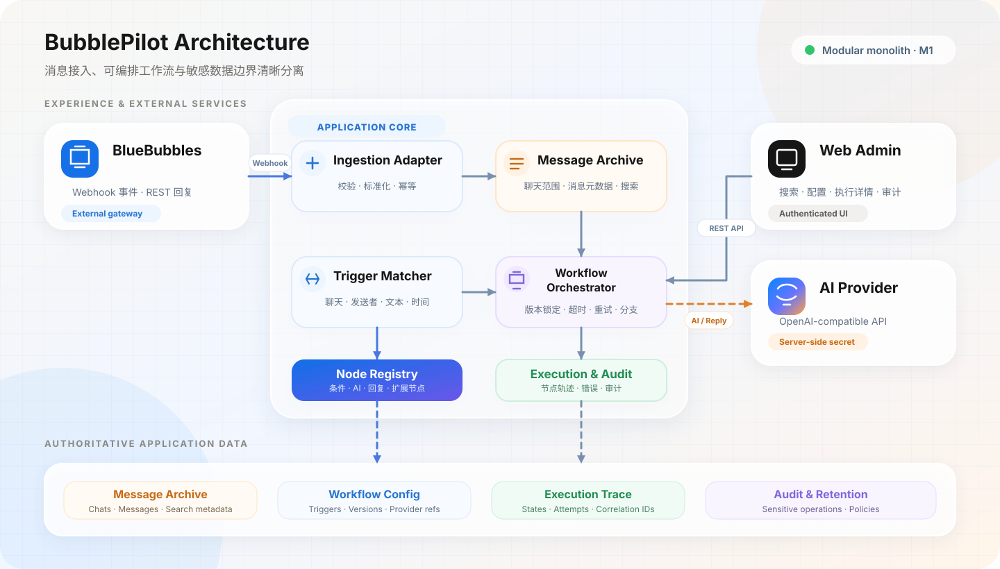

# BubblePilot 技术设计

## 设计目标

BubblePilot 优先保证消息不重复、执行可解释、配置可版本化和敏感数据不泄漏。在没有明确负载或隔离需求前，系统保持 TypeScript 模块化单体、PostgreSQL 和进程内执行队列；外部适配器、节点注册表和 Dispatcher 接口为后续拆分保留边界。

必须长期保持的原则：

- 所有入站消息先转换为带版本的统一消息信封，再进入归档和匹配。
- BlueBubbles REST 与 Webhook 细节只存在于项目适配器，不进入业务模块。
- 工作流节点通过稳定合同和注册表扩展，编排器不按节点类型堆积分支。
- 节点配置是数据，发布前必须校验；已发布版本不可原地修改。
- 应用数据库是配置、归档、执行和审计事实的权威来源。
- Secret、消息正文、完整 Prompt 和原始外部响应不进入普通日志。

## 总体架构



```text
BlueBubbles Webhook
        ↓
Integration Adapter → Message Envelope → Ingestion / Archive
                                            ↓
                                      Trigger Matcher
                                            ↓
                                      Dispatcher / Engine
                                            ↓
                      Node Registry → Context / AI / Reply nodes
                                            ↓
                             PostgreSQL execution and audit facts

Web UI → authenticated application API ────────────────┘
AI nodes → OpenAI-compatible providers / optional SearXNG
Reply node → BlueBubbles REST adapter
```

模块职责：

| 层                                         | 责任                                           | 不负责                        |
| ------------------------------------------ | ---------------------------------------------- | ----------------------------- |
| `app/`                                     | 配置、HTTP 组装、认证边界和进程生命周期        | 供应商字段适配、节点业务逻辑  |
| `modules/integrations/`                    | BlueBubbles Webhook 和 REST 的供应商适配       | 归档、匹配和工作流决策        |
| `modules/ingestion/`                       | 统一消息信封、外部事件认领和接入结果           | 具体节点执行                  |
| `modules/archive/`                         | 聊天、消息、搜索和内容保留                     | 把 BlueBubbles 当作查询数据库 |
| `modules/workflow/`                        | 触发匹配、版本图、Dispatcher、节点注册和执行   | 直接访问供应商 API            |
| `modules/ai/`                              | Provider、路由、Secret、AgentRunner 和工具调用 | 获得管理权限或改写归档        |
| `modules/auth/`、`export/`、`reliability/` | 会话、受控导出、限流和容量保护                 | 只依靠前端做权限判断          |
| `apps/web/`                                | 管理界面和及时收起敏感内容                     | 作为授权或并发控制边界        |

依赖方向是 `app → domain contracts → adapters`。业务模块依赖项目接口，不依赖 BlueBubbles 或某个 AI 供应商的原始模型。

## 代码与机器契约

```text
BubblePilot/
├── app/                 # 应用入口、配置、认证与 HTTP 组装
├── modules/             # 领域模块和外部适配器
├── apps/web/            # Vue 管理端
├── contracts/           # OpenAPI 与 JSON Schema
├── migrations/          # 只追加的 PostgreSQL 迁移
├── tests/               # 单元、API 与数据库集成测试
├── scripts/             # 校验、备份、诊断和升级脚本
├── doc/                 # 中文权威文档
├── compose.yaml
└── Dockerfile
```

机器合同的职责：

- `contracts/message-envelope.schema.json` 定义供应商无关的消息信封；
- `contracts/workflow.schema.json` 定义可发布的工作流图；
- `contracts/bluebubbles-webhook.schema.json` 约束适配器输入；
- `contracts/openapi.yaml` 定义管理和查询 API。

运行时路由、环境变量和机器合同由 `pnpm contracts:check` 交叉检查。

## 数据归属与核心实体

| 实体                                    | 作用                               | 关键约束                                                |
| --------------------------------------- | ---------------------------------- | ------------------------------------------------------- |
| `Chat`                                  | 供应商聊天元数据和监听状态         | 未监听聊天不保存新消息正文                              |
| `ChatParticipantIdentity`               | 单个聊天内 sender ID 的本名和昵称  | 只能映射该聊天历史已出现 ID，独立版本控制，不跨聊天共享 |
| `Message` / `MessageImageSummary`       | 标准化归档消息、链接预览与图片摘要 | 供应商消息 ID 唯一，正文、卡片和派生摘要受保留策略控制  |
| `InboundEvent`                          | Webhook 认领、接入状态和自动化判定 | 外部事件键唯一，不保存原始 Payload                      |
| `Workflow` / `WorkflowVersion`          | 工作流身份、启停状态和不可变版本   | 生产执行只引用已发布版本                                |
| `Trigger`                               | 消息条件与发布版本的绑定           | 启用状态、条件和冲突提示可审计                          |
| `Execution` / `NodeExecution`           | 一次逻辑执行及每个节点尝试         | 锁定消息、Trigger、Workflow Version                     |
| `OutboundDelivery`                      | 回复发送状态和幂等键               | 结果未知或已确认时禁止重发                              |
| `AiProvider` / `AiRoute`                | Provider 配置、固定顺序和版本路由  | Secret 只保存密文，运行时健康不改写固定顺序             |
| `AiProviderAttempt` / `AiToolExecution` | AI 请求和工具诊断                  | 只保留脱敏摘要与有界结果                                |
| `AdminSession` / `AuditEvent`           | 登录会话、二次授权和敏感操作审计   | 数据库只保存会话 Token 的 SHA-256                       |
| `DataExport`                            | 冻结预览、确认和短时下载           | 按所有者、聊天、时间和大小限制                          |

迁移 0050 增加 `workflow_bot_identities`、`message_bot_attributions` 与 `bot_attribution_jobs`。工作流 ID 是稳定角色身份，昵称独立版本化；执行和出站记录冻结当时身份，恢复执行继承原快照。归档通过供应商、聊天与消息 ID 精确连接出站记录，唯一匹配才关联工作流、版本、执行和节点。没有匹配或多重匹配保留 unknown-self，并保存诊断原因，不按正文或时间猜测。

首次昵称可补充准确匹配历史的空昵称，此后改名不改历史快照。后台归属任务采用租约和分批游标，清理后的正文不恢复。身份变化影响已有检索片段时提升聊天身份修订号，撤销旧派生数据和运行中任务；新结果提交时复核修订号，避免迟到结果覆盖。未知来源的诊断原因不参与证据身份哈希。

迁移 0050 隔离旧格式向量片段，0052 删除聊天摘要；管理员手动启动重建，迁移与昵称保存不调用模型。共享聊天原文仍可见，只有当前 workflowId 的消息作为 assistant，其他角色及未知本账号消息作为带作者信息的 user 参考资料。角色隔离是来源标识与提示协议，不是跨角色消息访问权限，也不承诺消除模型混淆。接口及维护入口见[接口与配置契约](接口与配置契约.md)，重建和回滚见[部署与运维](部署与运维.md)。

BlueBubbles 不提供 BubblePilot 工作流版本、监听配置、执行状态或审计记录，不能在恢复时反向推导这些事实。

## 状态与生命周期

### 入站事件

```text
received → processing → archived / ignored / failed
                         ↓
              evaluation-pending → matched / no-active-triggers / no-trigger-match
```

归档成功但执行容量不足时保留 `evaluation-pending`。BlueBubbles 重投同一事件可以继续调度；最终判定和历史 `not-evaluated` 不使用当前配置补跑。

入站归档采用“基础消息先落库、有限预览后补充、再调度工作流”。链接预览优先来自 BlueBubbles `payloadData`，缺失时可由受 SSRF 防护的 Open Graph 客户端访问公网 URL；预览写回使用 `pending` 条件更新，只有一个并发请求能提交最终状态，竞争失败方回读数据库权威快照。已完成预览不能被二次覆盖。原始卡片载荷、网页 HTML 与图片二进制不落库，正文保留任务会同时清除规范化预览内容、卡片主图 URL和派生图片摘要。

新消息提交后，图片附件会创建持久化 `MessageImageSummary` 任务；链接预览权威快照提交且存在主图后，再为主图创建任务。进程内 Worker 使用数据库 `SKIP LOCKED`、周期续租、有限重试和退避领取任务，同一消息、来源类型和来源键只生成一次。任务只选择启用路由中已验证图片输入能力的 Provider，不携带聊天历史、联网搜索或工具，不允许退化成未看图的文本请求。摘要请求失败不影响入站消息或工作流，应用重启后会继续领取未完成任务。现有历史图片不批量回填。

### 工作流与执行

- 工作流只有已校验候选版本才能发布；启用时锁定当前发布版本供新执行使用。
- 发布新版本不会改写已经开始的执行。
- 执行通常经历 `queued → running → succeeded`；临时故障可进入 `retrying`，耗尽后进入 `failed` 或 `dead-lettered`。
- 人工恢复创建关联的新执行，不覆盖源记录；人工关闭进入 `closed` 并保留轨迹。
- 编排器不配置工作流或节点总时间预算。Provider、SearXNG、BlueBubbles 和 PostgreSQL 等叶子 I/O 分别限制单次请求；有限轮次、尝试次数和退避保证组合执行最终结束。PostgreSQL 使用 `DATABASE_QUERY_TIMEOUT_MS` 同时约束连接获取、客户端查询等待和服务端语句执行。

### AI Provider

Provider 可配置统一的默认推理强度，由 OpenAI 兼容适配器按 Chat Completions 的 `reasoning_effort` 或 Responses 的 `reasoning.effort` 输出；`default` 表示不发送字段。该值在同一 Provider 的普通请求、Agent 工具轮次、重试和能力探测中保持一致，具体等级支持由模型或兼容网关决定。

管理员配置的启停和固定顺序，与运行时 `healthy / degraded / half-open` 健康状态相互独立。达到失败阈值的 Provider 在冷却期内退出常规候选；恢复时间到达后，每轮最多允许一个半开探测。

需要多账号池粘性路由的兼容 Provider 可以显式启用 `session-id-header` 会话亲和。系统按 Provider、BlueBubbles 聊天、工作流和 AI 节点生成稳定的不可逆会话键，通过 `X-Session-ID` 请求头发送；Responses 同时使用该值作为 `prompt_cache_key`，让账号池亲和与上游长前缀缓存采用同一个逻辑会话键。该值不会包含原始聊天标识，也不随执行、Agent 轮次、Retry 或工具调用变化。单次请求的 `X-Client-Request-Id` 继续保持唯一，用于审计和排障。其他 Provider 默认不发送会话头或缓存键。

AI 用量观测直接聚合 `ai_provider_attempts`：长周期固定为管理端本地时区的今日、ISO 周和自然月，实时序列支持最近 1/6/12/24/48 小时并自动选择时间桶。请求数按真实 Provider Attempt 计数；缓存命中率使用 `SUM(cached_prompt_tokens) / SUM(prompt_tokens)` 的 Token 加权口径，只统计明确返回缓存字段的请求。聚合结果不保存新的消息或 Prompt 数据；当前直接查询 Attempt，数据规模需要时再演进为每日 Rollup。

AI 路由层为普通回复和图片摘要统一保存 `ai_route_traces`。每条记录固定执行时的路由名称与版本、请求能力要求、候选顺序、能力与健康过滤原因、原生图片或纯文本降级阶段以及最终状态；Provider Attempt 通过追踪 ID 和阶段与之关联。追踪只保存配置诊断和状态，不保存 Secret、图片内容、聊天正文、完整 Prompt 或 Provider 原始响应。旧记录不使用当前路由配置反推历史决策。

#### Prompt Cache 优化原则

BubblePilot 通过稳定请求前缀提升兼容 Provider 的 Prompt Cache 命中率：

1. 固定身份：会话缓存键、Session ID、消息 ID 和发送者 ID 保持稳定。
2. 稳定前缀：固定协议、系统提示、静态任务和既有历史保持确定顺序；链接预览、历史图片或其摘要固定在所属历史消息中，当前轮动态输入继续后置。
3. 批量推进：原文增长到基础窗口与缓冲窗口之和时，一次移出最早的缓冲窗口；数据库触发快照保证排队执行边界固定。
4. 隔离动态状态：成员映射、动态任务、当前图片和失败诊断后置；历史资源状态只允许在对应消息内从原图变为摘要或固定不可用文本。
5. 保证一致性：并发结果以数据库为准；同一 Agent 交互锁定 Provider 并保持请求参数稳定，同时记录首个差异位置和推测原因。

核心原则是尽量让请求前缀长期稳定，把不可避免的变化集中在请求尾部，并把原文移出限制在可预测的窗口边界。具体消息分区、引用格式及图片和链接预览布局见[事件与工作流设计](事件与工作流设计.md#context-模板与-prompt)。

原生图片输入是 `modules/ai` 内的进程内适配能力，不增加服务边界。启用时，节点从 BlueBubbles 临时读取有限附件，并通过与 Open Graph 相同的 SSRF 防护读取公开卡片主图；异步图片摘要复用相同的下载、可信主机、魔数、大小和超时合同。Chat Completions 与 Responses 分别使用其原生图片内容块，Agent 多轮和同节点 Provider Fallback 复用已准备的 Data URL，不重复下载。原图与 Base64 始终不落库；`MessageImageSummary` 只保存稳定引用、来源键、内容 Hash、有限摘要、状态、模型快照、耗时、错误码和租约信息。管理端只在敏感消息查看接口中返回摘要正文；图片预览根据消息 ID 和稳定引用由服务端即时代理，不把 BlueBubbles 凭据或原始附件标识写入预览 URL。

路由将图片、联网搜索和健康状态能力条件取交集。普通对话的视觉候选全部失败后可移除图片并走文本候选，且明确限制模型不得伪称查看过图片；`image-summary` 用途禁止该降级。`AiImageInput` 只保存来源类型、状态、MIME、字节、耗时、主机名、来源哈希和错误码。`AiProviderAttempt.purpose` 区分对话回复和图片摘要；图片摘要计入 Provider 总用量，但无工作流执行 ID，不进入执行列表的回复缓存命中率。

### 受控导出

```text
previewed → confirmed → downloadable → downloaded / expired
     └──────────────────────────────→ cancelled
```

预览冻结 `snapshotAt` 和数量；确认必须回传相同快照，下载时再次检查所有者、监听状态和有效期。正文直接流式生成 JSON Lines，不写临时明文文件。

## 幂等与一致性

| 边界     | 稳定键                                                     |
| -------- | ---------------------------------------------------------- |
| 入站事件 | `provider + externalEventId`                               |
| 归档消息 | `provider + providerMessageId`                             |
| 触发执行 | `eventId + workflowVersionId + triggerId`                  |
| 节点尝试 | `executionId + nodeId + attempt`                           |
| 出站回复 | `executionId + replyNodeId`，并保存稳定 `providerTempGuid` |

事件认领、Chat Upsert、消息写入和接入状态在事务中完成。外部发送超时或网络中断无法证明是否生效，应记录 `unknown`，不能把“没有收到响应”当作“没有发送”。

## 消息保留与删除

- 默认从归档入库起保留正文和附件元数据 90 天。
- 到期后只清理敏感内容，保留消息身份、幂等和执行关联；`contentRedactedAt` 区分“原本无正文”和“已按策略清理”。
- 有效导出或仍可恢复的执行会推迟内容清理。
- `MESSAGE_RETENTION_DAYS=0` 明确关闭自动清理，不是推荐默认值。
- 清理批次与 `message.content.retention` 审计在同一事务提交。
- 聊天软删除只写入 `deleted_at`，保留聊天行及其消息、执行、导出和成员映射；已删除聊天从监听列表隐藏，历史引用仍显示聊天名称。已删除聊天重新收到消息会清除删除标记并恢复同一聊天记录，但仍保持停用且不自动归档正文。

## 安全边界

BubblePilot 首期采用单实例管理员模型，但登录和敏感操作是两个独立控制项：

- 登录密码建立管理会话；敏感操作密码保护消息正文、监听变更、系统设置、审计、导出和人工恢复。
- 两套密码只保存独立 scrypt 哈希；服务端会话使用随机 Token，数据库只保存 SHA-256。
- Cookie 使用 `HttpOnly`、`SameSite=Strict`，生产 HTTPS 下增加 `Secure`；前端倒计时只负责及时收起界面，服务端仍逐请求校验。
- AI Provider API Key 和运行时 BlueBubbles 凭据使用 `SETTINGS_ENCRYPTION_KEY` 加密保存，列表和详情只返回是否已配置。
- 只有已监听聊天保存正文；搜索、导出和详情接口不能通过 ID 枚举绕过范围。
- 成员身份读取和修改需要二次验证；运行时按本次上下文的 sender ID 定向查询，不能向 AI 暴露当前窗口之外的映射。
- 日志、测试 Fixture、截图、Issue 和诊断不得包含真实消息、Secret、完整 Prompt、原始 Webhook 或未裁剪外部响应。
- 管理 API、Webhook、工作流并发和等待队列均有硬上限；通用容量等待有时间上限。同一 `Workflow ID + 消息 Provider + Chat ID` 的后续执行作为有序工作串行等待，不使用通用等待超时丢弃，避免慢 AI 请求造成消息漏触发；不同隔离键仍可并行，队列调度会跳过暂时被占用的键。

至少审计登录失败、二次验证、监听变更、工作流发布和停用、Provider 变更、导出、内容清理、凭据轮换、人工重试和死信关闭。

## 技术基线与重评条件

| 项目       | 当前选择                                      | 原因                                            |
| ---------- | --------------------------------------------- | ----------------------------------------------- |
| 运行时     | Node.js 22、TypeScript 5、ESM                 | 适合 I/O 密集型 Webhook、版本化合同和前后端协同 |
| HTTP / Web | Fastify 5、Vue 3、Vite                        | 类型清晰、模块轻量、管理端构建简单              |
| 数据库     | PostgreSQL 16                                 | 事务、唯一约束、JSON、锁和迁移能力满足消息幂等  |
| 校验       | Zod、JSON Schema、OpenAPI                     | 启动配置、工作流和 HTTP 合同可机器检查          |
| 测试       | Vitest、Fastify `inject`、PostgreSQL 集成测试 | 覆盖纯逻辑、API 权限和数据库一致性              |
| 部署       | Docker Compose                                | 单实例部署和运维成本可控                        |

只有出现以下证据时重新评估边界：单进程容量成为瓶颈、工作流需要强隔离、多个实例必须共享持久队列、数据库写入模型不再适配 PostgreSQL，或多租户权限成为正式范围。在此之前不提前引入微服务、Kafka 或任意脚本运行时。

## 演进路径

当前进程内 `WorkflowExecutionDispatcher` 和 `BoundedExecutionGate` 已隔离调度合同。未来迁移到独立 Worker 时，必须保持同一执行、重试、取消和幂等语义，并增加持久化原子 Claim；不能只把内存 Promise 队列移动到另一个进程。

## 长期聊天检索模块

`modules/memory/` 隔离 Embedding 协议、配置、切片、持久化任务和检索。PostgreSQL 16 + pgvector 保存原文关联、关键词与向量；首期采用同代次精确距离搜索，不建立 HNSW。Ollama `/api/embed` 禁止静默截断；兼容服务使用 `/embeddings`，校验批量位置、维度、有限数值与非零向量。不通过普通回复路由切换 Embedding 模型。

`memory_settings` 保存默认关闭的功能设置；`memory_generations` 固定模型、维度、问题前缀、配置和加密凭据。Ollama 优先记录 `/api/tags` 返回的模型 digest；不可获得时读取 `/api/show` 的模型元数据及 Modelfile，计算身份指纹。指纹是辅助变化检测，不等同于可验证权重 digest。兼容服务依赖管理员模型版本标识，不保证检测供应商同名替换。改变编码配置产生新代次，显式补建和覆盖检查后切换。

归档和派生图片摘要变化通过数据库触发器记录 `memory_jobs`，并立即失效受影响片段。任务使用租约、续租、最多三次尝试与退避，进程内单 Worker 每批编码最多四个片段。切片目标 800、上限 1600 字符，超过 30 分钟分段；长消息记录子片段偏移。增量任务首次入队延迟 60 秒以聚合尾部，同一队列窗口不会被持续消息无限推迟。历史任务固定索引上界及发送时间过滤条件，按扫描游标恢复，覆盖数量由实际成功消息关联计算。

消息清理与片段文本、关键词失效同事务执行，向量随后由 Worker 回收。查询必须过滤有效来源；执行内证据在再次发送 Provider 前重查源 Hash。历史证据不进入普通日志或持久化诊断；实际 Provider 原始请求（包括历史工具结果）允许在进程内最近 20 个执行的受控缓存中临时保存，仅通过服务端敏感验证后按需查看、复制，读取写入不含正文的审计。旧代次、索引任务和来源引用不能绕过内容保留或聊天授权。

新增默认数据库镜像及迁移运维步骤见[部署与运维](部署与运维.md)。普通迁移不依赖 vector 类型，专用准备命令独立建立向量扩展和表。后台失败不阻断归档；普通正文和图片摘要仍由原有模块负责。

### 补建进度与 ETA

迁移 `0047_memory_job_progress.sql` 为显式补建冻结消息成员元数据（ID、索引、字符量、处理状态），不复制正文；每批发布和成员状态更新共享租约验证事务，重复请求不增加计数。计数采用真实消息成员而不是最大消息索引，清理失效的待处理成员在处理游标经过该范围时记为 removed。任务完成后统计保持历史快照，后续保留清理由聊天覆盖状态反映。成员元数据随任务删除级联回收。

任务只保留最近 10 个成功批次样本；至少 3 批且累计 15 秒后，按字符吞吐估算剩余时间并按分钟向上取整，同时显示条/分钟。正常批次间隔计入速度，跨任务、暂停、失败和进程重启清空采样；60 秒无成功进度停止预估。单 Worker 身份及租约决定当前任务。初始字符量来自与索引相同的文本转换，后续内容变化可能使预估偏移，完成时刻不是承诺。

固定成员快照使轮询只聚合元数据，无需每 5 秒重新读取归档正文或计算剩余文本长度；查询优先保留当前运行任务及待处理任务，再按创建时间限定最多 100 个任务。旧任务在下一次处理时建立剩余范围快照，已结束旧任务不反推历史计数。

长期记忆管理复用页面侧栏和工作区，任务列表与单任务详情分开加载，游标按毫秒创建时间与 UUID 排序。分页失败恢复页码，关闭详情使未完成响应失效；原文弹窗使用原生 dialog 隔离键盘焦点，授权失效清空正文。列表及详情仅保存脱敏元数据。

Provider Attempt 响应诊断与原始请求共用最近 20 个执行的内存生命周期，不落库、不进入普通日志。响应按 clientRequestId 独立关联，重试不会覆盖相同请求哈希的其他响应；仅敏感验证后通过 `/api/v1/executions/{executionId}/ai-attempts/{attemptId}/raw-response` 查看和复制。正文最多保留 64 KiB（UTF-8 安全截断），同时返回原始字节数和截断标记。只提取 error 的 message/code/type/param 及请求关联 ID（x-request-id、request-id、openai-request-id、cf-ray、x-amzn-requestid、x-ms-request-id），不保存认证或 Cookie 响应头。错误字段仍属于敏感正文，不进入普通执行列表。未收到完整响应不伪造正文；空响应、HTML 和文本可区分。弹窗分为结果响应与错误详情、原始请求及缓存诊断；敏感会话失效清空正文并拒绝过期响应。

iMessage 格式约束优先放在文本模式 AI 节点的稳定系统提示中，不对 JSON 节点生效。BlueBubbles 发送端继续通过 normalizeIMessageText 转换常见 Markdown，并在转换前保护代码围栏和行内代码内容；不新增通用 HTML 标签剥除，避免误删代码示例。提示约束不能保证所有模型始终遵守；未标记的代码与排版文本仍存在歧义。

## Agent 运行预算边界

AgentRunner 使用每次运行独立的预算对象与配置快照，将联网及归档工具的调用、返回内容和执行时间统一管理；默认 10 次、64,000 字符、90 秒。Provider 内部重试与工作流重试属于各自原有层次；每个重新开始的 Agent 运行有独立快照，不将一个节点的预算冒充整个工作流预算。没有应用侧工具时直接调用模型，仍记录零工具使用的快照。

配置通过 `ai_agent_settings` 单例表及乐观锁维护，接入服务就绪检查与连接关闭。执行快照沿用节点 JSON 摘要，失败通过工作流异常的可选元数据传递，不新增执行记录表。工具超时的取消信号隔离迟到结果；历史证据先暂存，字符裁剪与权限复核后事务保存来源。原始工具正文维持既有敏感诊断边界，普通记录只增加预算元数据。

### 原始归档查询与统计

ChatQueryRepository 共用参数化筛选 SQL；原文查询按时间/索引 keyset 分页，计数与窗口首末值先对完整筛选集计算，再对分组分页。NULL 成员独立保留。单条 SQL 同一快照产生结果与 queriedAt；不承诺跨页冻结归档。MemorySession 在操作副本中维护游标、暂存来源，返回字符裁剪后才提交接受的来源和游标。计数没有消息来源；首末值保留可授权复核的原始消息，但仅序列化元数据。

迁移 0049 增加未清理消息的 (chat_id,sent_at,message_index) 与 (chat_id,sender_id,sent_at,message_index) 部分 B-tree 索引。未增加业务表、全文索引、扩展或工具专用额度；字面关键词全量统计仍可能扫描较多归档，受 SQL 超时限制，不能以不完整计数替代失败。


### 无聊天摘要的双窗口上下文

聊天上下文使用基础窗口 B 与缓冲窗口 R，默认各 10 条，范围各 1～50 条。历史原文达到 B＋R 时批量移出最早 R 条，返回 B 条；当前触发消息单独追加、不计入历史窗口。实际可读记录参与计数，不以索引差推算。移出只影响模型输入，归档和向量索引不删除。字符保护默认 6,000，范围 100～20,000；在消息窗口之后保留最新完整后缀，单条超长消息保留并说明超限。

`conversation_context_settings` 是四项全局配置的权威来源，`conversation_context_windows` 按聊天与触发消息保存无正文的不可变窗口检查点。归档提交后创建检查点，执行创建时引用同一快照；检查点失败不阻断归档，加载上下文时补建受触发边界限制的兼容快照。权限或正文清理仍在读取时复核。原文窗口不依赖 AI、摘要游标、索引 Worker 或向量代际。

0052 定向删除聊天摘要表、状态与任务、专用 AI 诊断和普通执行快照中的已知摘要字段。原始归档、图片摘要、链接卡片、向量、角色和通用审计元数据保留。模型系统协议不再包含 history_summary 分区，检索工具负责按需补充历史证据。


### 表情素材、摘要与投递生命周期

`modules/memes` 管理独立素材仓储、文件存储接口、租约摘要任务及图片投递协调。应用数据库持有素材元数据和投递权威状态；BlueBubbles 只负责传输。素材原文件不可修改，随机存储键与 SHA-256 哈希分离，内部目录不公开。鉴权内容接口返回原文件/静态预览，日志不记录文件、正文或摘要。

迁移0053新增 meme_assets、meme_summary_jobs、meme_reply_plans，并扩展 outbound_deliveries。上传事务串行化相同哈希，回滚清理孤立文件；定期清理超过24小时的孤立目录。逻辑删除立即退出搜索，未关闭的 pending/sending/failed/unknown 投递继续保护文件。无引用删除素材超过24小时后文件可回收，元数据保留。

摘要任务最多3次，使用数据库租约，首个启用且含已验证图片 Provider 的路由负责生成。生成用量 purpose=meme-summary；初次仅在未人工修改且版本一致时写摘要，否则保存为候选。重生成也保存候选，管理员明确采用。过期租约及删除素材的迟到结果不覆盖内容。

组合回复在同一数据库事务创建文字/图片独立投递项和加密正文计划。正文计划使用实例 SETTINGS_ENCRYPTION_KEY 加密，随执行投递记录级联清理，备份需保留该密钥。原文不写入普通日志。投递用条件更新取得发送权；已确认项不重复发送。发送租约过期转 unknown，禁止自动重发；恢复只发送未曾发送的 pending 项，文字未确认时图片不会发送。关闭图片跟进保留原始状态，移出待处理列表。

### 合集归属与摘要输入版本（0054）

`meme_collections` 保存名称、说明、封面引用、乐观锁版本及时间；`meme_assets.collection_id` 可空，`collection_joined_at` 确定默认封面顺序。合集名称去除首尾空白且不区分大小写唯一，“全部表情”“未分类”为保留名称。合集成员统计只排除逻辑删除，默认封面按加入时间与 ID 稳定排序，手动封面必须是有效成员。

成员移动、上传归属和合集删除使用同一 PostgreSQL 事务 advisory lock 协调；批量操作按稳定 ID 顺序锁定素材，逐项核对版本与存活状态，响应保持请求顺序。删除合集先清空成员归属并递增素材管理版本，再删除合集。批量删除沿用素材逻辑删除；文件清理仍由既有未结束投递引用保护决定，不复制或移动原文件。

选择接口在单个查询快照内读取固定 ID 与版本，读取 5,001 条用于检测超限，超限直接拒绝。它不是持续变化的查询令牌，之后新增素材不进入已选范围。

`summary_input_version` 将摘要输入变化与管理变化分开：名称、描述、标签及人工摘要操作递增输入版本，合集移动与启停只递增素材管理版本。新摘要任务保存 `input_version`；生成结果仍受租约、删除、人工修改及输入版本检查保护。迁移前任务的 `input_version` 保留 NULL，继续使用原 `base_version` 保守检查，不反推历史输入。


### 表情使用统计与排序

迁移 0055 为素材增加 usage_count、last_used_at，为投递增加 usage_counted。数据库触发器在未计数表情投递首次确认时原子递增并标记；最近时间取最大 confirmed_at，事务失败全部回滚。关闭后的迟到确认不计数，发送服务仍保留租约隔离。统计不修改管理版本、摘要输入版本和资料更新时间；删除投递不扣减累计值。迁移从仍可关联素材的 confirmed 表情投递回填，缺少确认时间只计次、不推测时间。

## 表情工具诊断

表情工具复用 ai_tool_executions 的 request_details/response_details JSON，使用 version=1、kind=meme 的白名单诊断，不新增表或迁移。诊断从本轮实际接受的工具结果生成；超时和预算拒绝优先，迟到结果不改变选择或诊断。保存关键词数量、限额、候选数、截断及受控状态，不保存搜索原文、素材描述、摘要或任意异常文本；查询指纹沿用既有逻辑。选择工具 resultCount 为 null。

生产继续使用字面检索，不包含表情向量索引或后台向量任务。离线表情评测入口及专用素材已按本轮范围收敛移除，保留协议与诊断的功能回归测试。

## 运行内图片引用与请求关联（0056）

`ChatImageSession` 管理运行级随机引用、初始图片与工具追加的共享额度、已接受载荷及待追加队列；`ChatImageSourceRepository` 从应用归档数据库复核聊天、触发消息边界、归档清理与长期记忆授权。当前窗口允许沿用上下文访问范围，窗口外引用只从历史工具裁剪后的已接受证据产生。引用不接受任意外部地址，也不跨运行复用。候选与载荷只保存在当前进程的运行对象中。

工具返回合同兼容原有字符串，并增加带完整文字结果和受控提交回调的内部结果。下载、内容检查和再次授权校验先完成，文字必须完整落入剩余字符额度才能提交；提交前检查取消信号及截止时间。来源撤销、附件变化及超时后的迟到操作不得追加载荷或成功额度。下一轮和每次 Provider 重试前再次复核已接受图片的来源；最终结果交付前也复核。自动输入与工具输入共用图片设置快照；读取使用 BlueBubbles `original=false`，不主动缩放或转换。尺寸读取使用集中定义的像素保护值，不保存图片副本。

迁移 0056 为 `ai_image_inputs` 增加可空 `diagnostics`，为 `ai_provider_attempts` 增加可空 `image_inputs`。图片诊断 version=1 包括来源、触发方式、工具调用 ID、轮次、SHA-256、尺寸及兼容版本。Provider 请求清单由请求适配器设置 `dispatched`，记录实际携带的图片记录 ID/哈希，涵盖重试和 Fallback；不能从路由选择推断网络已发起，更不能据此推断对端接收或模型理解。工具诊断复用既有 JSON 字段，只允许受控状态和引用元数据。旧记录保持 null，不回填。

### 图片审计安全边界

执行详情普通列表仅返回诊断元数据。图片预览和来源正文必须通过管理员认证及现有敏感操作验证，响应 `Cache-Control: no-store`。预览根据执行 ID／图片记录 ID 解析归档，重新校验读取权限、清理状态、附件身份和内容哈希，不接受 URL。源缺失或哈希不同返回不可还原，不能把重新读取的不同内容展示为历史图片。Web 仅在明确点击后获取 Blob，解锁失效、切换记录及卸载时撤销 Blob URL，迟到响应不打开预览。普通日志不新增图片、Base64、正文或摘要。

### 严格工具 Schema 边界

`modules/ai/tool-schema.ts` 集中提供供应商 Schema 转换及 Agent 参数还原，业务 Schema 不被原地修改。支持现有工具使用的对象、数组、标量、nullable 类型、anyOf、enum/const 和范围／字符串约束；const 转换为单值 enum。引用、开放字典、其他未支持关键字及无法安全处理的结构在请求发出前返回 `AI_TOOL_SCHEMA_INVALID`，携带工具名和 Schema 路径，不重试、不降级、不计入 Provider 健康失败。anyOf 中多个可能分支若还原结果不同，保留原值交由业务校验，不猜测参数含义。

本次不改变图片能力探测状态策略，不永久新增 Prompt、参数正文或供应商错误正文日志。严格 Schema 变化可能使首次上线请求重新建立提示缓存；后续相同配置下生成结果稳定。

### Web 交互边界与模块导航

工作流画布快捷键在编辑器 DOM 范围内处理，输入控件、富文本子元素、弹窗、已处理事件和输入法组合输入不触发画布命令。复制、粘贴、撤销和删除共享 `keyboard-scope` 判定；删除由编辑器统一执行，禁用 Vue Flow 的独立删除快捷键。画布点击建立键盘焦点，其他页面和顶栏不受画布快捷键影响。

模块导航的 DOM 测量、滑块、监听器与锚点恢复集中在 `useSectionNavigation`，组件保留现有样式。侧栏点击以路由 hash 保存模块并保留查询参数；刷新后按可见模块恢复。路由滚动策略独立维护：切页回顶部，同页查询参数变更保留位置，浏览器后退/前进使用保存位置。现有后端 API、工作流格式和数据库结构不变，无需重新保存工作流。

跨页跳转到具体业务模块的入口必须携带模块锚点（如降级 Provider 指向 `/ai#providers`），不能仅打开页面后依赖继承滚动位置。公共模块导航在目标首次定位后监听异步布局变化并重新对齐；普通滚动事件不触发重新对齐，用户滚轮、触摸、指针或键盘操作立即解除跟随。概览的 Provider、聊天、执行和恢复入口以及角色弹窗的聊天管理入口遵循此约定。

工作流清单导入使用管理员登录权限（含创建工作流及追加候选版本），不要求敏感授权；通过 `requireAuditedAdmin` 保留服务端认证、同源检查和导入审计。预览令牌、绑定重检及候选版本语义不变，发布/启用接口保持现有管理员权限，本次不调整。导入 UI 复用挂载于 body 顶层的原生详情弹窗，避开页面动画的定位/层叠上下文；不透明背景、内部滚动、焦点约束和关闭后焦点恢复由公共组件负责。导入错误留在弹窗内；读取、校验及提交期间禁止重复操作和关闭。

## 声明式插件运行

新增 plugins 模块：包解析、文件存储、MCP 适配、安装管理和运行会话。0057 迁移保存 plugins、plugin_versions、plugin_imports；文件写入完成后才能切换数据库版本引用。安装任务状态可轮询，应用重启将中断任务标为失败。包按内容 SHA-256 存储，配置使用现有 SettingsCipher 加密；插件身份版本唯一，同名同版本不同内容拒绝。

新执行固定插件版本和工具定义。插件 MCP 客户端按运行隔离，结束时关闭；调用前后校验启停和授权，发现 Schema 变化只拒绝受影响工具，不自动扩大授权。SDK 负责 MCP 传输，项目适配器负责地址策略、预算和结果转换。默认公网 HTTPS，管理员显式批准后才允许内网；实际 socket 使用校验后的 DNS 地址，拒绝重定向和跨源凭据传递。包内配置不能读取宿主环境变量。

AgentToolRegistry 增加 plugin 诊断类型；MCP、load_plugin_skill 和 read_plugin_reference 使用已有共享调用／时间／字符预算。首轮仅提供 Skill 元数据，指令与参考文件按需加载，不能提升系统权限；没有成功加载 Skill 时不能读取其参考文件。不执行包内代码，不处理二进制或 UI 工具结果，不自动重放工具请求。外部 Skill 的自然语言依赖无法完全静态验证，运行时仍限制可调用工具和可读取文件。

### 共享 Fake-IP 信任策略

迁移 0058 将图片原有可信域名复制到 `network_settings` 单例，作为唯一运行时权威来源。图片及 Open Graph 读取、插件 Git 导入、MCP HTTP 请求共享 `public-network-policy` 地址检查与域名列表。精确域名匹配仅豁免 IPv4 `198.18.0.0/15`，不开放普通私网、回环或链路本地地址。Git 继续固定 DNS、禁止重定向与脚本；MCP 每次 HTTP 请求重新读取策略、固定 DNS 并拒绝跨源及重定向。已有 MCP 的逐连接内网授权独立保留，不由 Fake-IP 域名列表隐式授予。

旧图片字段保留为响应兼容别名；旧数据库列仅保留升级前数据供回滚核对，不再控制运行策略。图片设置保存未传旧字段时不影响共享配置，尝试通过旧字段更改域名返回 `NETWORK_SETTINGS_MOVED`。图片运行仍按既有方式读取运行配置；调整信任列表不撤回已下载图片或正在执行的 Git 下载。

### Git 插件目录链接

Git 导入先解析 GitHub tree/blob 目录链接，通过远端 heads/tags 核对分支边界；含斜杠的分支与目录不按首段猜测，多解返回 GIT_SOURCE_AMBIGUOUS。解析后固定提交 SHA，以 blob:none 部分克隆获取树，仅读取选定目录对象，不 checkout、不运行脚本或下载子模块。文件数、解码及文件体积限制作用于选定目录；整个暂存区仍有磁盘和时间上限。符号链接及 gitlink 在选中目录内拒绝。安装来源保留规范化仓库 URL、目录和 SHA。

### MCP JSON Schema 与模型参数边界

MCP 工具契约按 [2025-11-25 Tools 规范](https://modelcontextprotocol.io/specification/2025-11-25/server/tools)处理，未声明 `$schema` 时使用 JSON Schema 2020-12；显式支持 2019-09 和 draft-07。每份 Schema 独立编译，支持本地引用，不下载远程引用，不执行异步校验，不自动填默认值、类型转换或删除字段。`format` 按注解处理；未知断言关键字、未支持方言和不能解析的引用明确拒绝，不能通过忽略约束来假装兼容。

MCP 的 `inputSchema` 不套用模型供应商的严格模式子集。全部外部 MCP 工具在模型侧统一使用必填字符串 `arguments_json` 封装，字段说明携带原始 Schema；应用解析为对象后按原始契约校验，再调用 `tools/call`。因此动态属性、`propertyNames`、联合类型、可选字段及显式 null 均保持原义。封装仅存在于模型适配层，MCP 服务仍收到标准的 arguments 对象；内置工具及 Skill 工具沿用原有参数协议。

可选 `outputSchema` 随批准定义保存并纳入哈希；成功结果必须携带符合契约的 `structuredContent`，`isError` 结果不要求满足成功输出契约。旧记录缺省无输出契约，不反推历史。工具发现使用总时间与页数上限，拒绝循环 cursor；仅支持同步工具执行，要求 task execution 的工具明确报告不支持。连接、发现与调用错误转换为受控认证、限流、超时、协议或传输错误，不回显任意服务端异常文本，不自动重放调用。

### 插件目录预算的计数口径

`pluginCatalogueUsage` 复用 PluginSession 的实际注册定义和 Skill 目录，计算两者规范 JSON 字符数；不是 HTTP 请求字节数或 Token 数。只包含启用能力，包含模型侧 JSON 参数封装、工具命名空间、Skill 来源标识与共享加载工具，排除输出 Schema、批准哈希及停用能力。统计与运行注册共用逻辑，避免存储字段演进导致误判。内置工具、角色提示词、聊天上下文、工具执行结果另受既有预算控制。

迁移 0059 新建单例 `plugin_runtime_settings`，默认 64,000 字符；管理员可设置 8,000–256,000。新执行开始时检查当前上限，既有执行不中途改变工具定义。设置使用版本并发控制；不改变模型上下文窗口，不截断 Schema，不放宽授权。设置页显示各插件占用及共享开销，提示实际按工作流所选插件校验。

## MCP 大结果与运行内读取

MCP 响应先按协议及输出 Schema 校验，再整理模型可见内容。仅当文本块可解析为 JSON 且与 structuredContent 深度相等时去掉该文本副本，保留其他块和结构化对象；不做语义相似去重。工具正文仍为不可信参考材料。

PluginResultStore 按运行隔离，完整规范化正文以字符串暂存于内存，累计 UTF-8 上限 30 MiB；不写文件或数据库，结束/取消时释放，不支持重启恢复或审计正文回放。结果引用绑定固定插件版本和工具，读取前后复核授权。暂存通过现有 commit 合同在完整文字可交付且未超时后提交；迟到结果不生成可用引用。原始传输响应不长期保留。

单次 MCP/结果读取输出上限 16,000 JavaScript 字符（含 JSON 包装），同时受累计剩余额度限制。大结果返回合法包装、头尾节选、省略范围和引用；优先在换行处切分，不假装节选是完整 JSON。读取位置按 Unicode 码点计量，与预算的序列化字符串长度分开。单次部分交付不消耗未展示正文额度，也不触发全局收尾。后续读取重复计额，不重发外部请求。Skill 必要正文仍要求完整交付。

网络响应独立限制 30 MiB；MCP tools/call 超时取 45 秒与 Agent 剩余时间较小值；初始化与发现沿用 30 秒且受 Agent 总截止时间约束。网络超限、暂存超限、单次超时和累计预算拒绝分别诊断。本轮未加入整体上下文 Token 容量管理或自动摘要/压缩。
