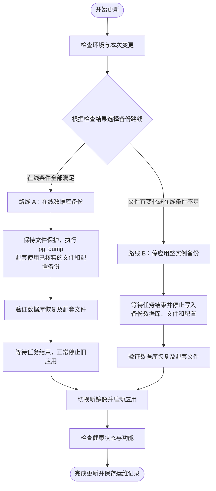

# BubblePilot 备份、升级与恢复操作手册

本文是日常部署的统一操作入口，供管理员和协助运维的 Agent 使用。首次部署、环境配置及各版本迁移要求见[部署与运维](部署与运维.md)；发布镜像与 CI 规则见[开发与发布](开发与发布.md)。本文集中维护操作顺序、停止条件与交付记录，不替代具体版本的兼容说明。

## 1. 先检查，再选择备份路线

**每次升级都先检查变更范围、配套文件备份与写入条件，再决定路线：条件全部满足时采用在线数据库备份；发现差异、证据缺失或无法控制文件写入时，采用停应用整实例备份。** 不是一律停机备份，也不是 UI 小改动就自动允许在线备份。

| 路线 | 保障范围 | 判断结果 |
| --- | --- | --- |
| A：在线数据库备份＋已核实的配套文件备份 | 本次数据库一致性快照，配合经过校验的已有文件及本次配置备份 | 第 3.2 节检查全部通过，并能持续保障文件一致性 |
| B：停应用整实例备份 | 同一停止写入窗口的数据库、插件与表情文件；另存配置和密钥 | 版本要求停写备份、文件不匹配，或任一必要条件未通过／未知 |

两条路线均提前拉取镜像、验证备份，再切换应用。路线 A 减少的是**备份期间**的停机，应用容器切换仍可能短暂中断；路线 B 备份期间不重启旧应用，验证后直接启动新版。

不能因为时间紧、页面健康或文件数量相同省略检查。用户已明确指定备份方式时按授权范围执行，并如实说明恢复范围；不能把缺少配套文件的数据库备份称为整实例可恢复备份。本节是人工运维决策流程，现有脚本不会自动判断路线，也没有新增文件写入冻结功能。

范围是 BubblePilot 应用栈。BlueBubbles、SearXNG 自定义配置、OpenSandbox/MCP 独立栈及外部数据库需另外盘点、备份和验证；应用备份不包含网关附件原件。任务内沙箱与附件临时目录不纳入长期备份。

两种备份都只能恢复到备份时点，不能自动保留此后的消息、配置和出站状态。停止应用期间 Webhook 是否补投取决于网关，不能承诺零消息遗漏；恢复后核对该时间段接收情况，历史补录不得盲目重放工作流。

## 2. 首次接手实例：建立受保护的运维档案

开始操作前核实并记录以下信息，后续每次部署更新它们：

- 正确的主机、Compose 项目、栈目录、服务名、实际使用的 Compose 文件与 override、环境文件及项目参数。
- 当前应用提交、镜像 digest、PostgreSQL 镜像与主版本、迁移版本、健康检查地址。
- 数据库卷、表情目录、插件目录的实际挂载；是否有额外持久化目录或外部写入者。
- 配置文件及 Secret 文件的受保护存储位置，尤其是原 `SETTINGS_ENCRYPTION_KEY`；不能在操作日志、聊天或 Git 中记录密钥值。
- 最近可恢复的备份集、校验记录、异机副本、备份占用与可用空间；预留镜像、备份和临时恢复库的空间。
- 定时提醒、空闲主动交流、在途工作流和未知投递的检查入口；维护窗口及监控方式。

仓库脚本按**脚本所在目录的上一级**寻找 Compose 栈。生产脚本必须与对应栈放置正确，不能在本地源码目录调用脚本却以为操作的是 NAS。若使用额外 Compose 参数或自定义存储路径，先确认脚本使用相同配置；标准整实例脚本固定备份 `/app/data/memes` 与 `/app/data/plugins`，自定义路径必须另行覆盖，不能漏备份。

后续示例假定已经进入正确栈目录、使用默认 Compose 文件与服务名 `app`、`postgres`，且宿主具备 `sha256sum`。逐段执行并检查结果，不能将全篇直接粘贴成无人值守脚本。

## 3. 每次升级的标准流程

### 3.1 确认范围，先准备镜像

1. 阅读本次 Release Notes 和[版本升级要求](部署与运维.md#升级与回滚)，确认迁移、数据删除、配置和插件合同变化。仅更新应用时，不顺带更新数据库、搜索或沙箱。
2. 确认发布验证已通过，记录目标提交与精确镜像 digest；不把可变 `dev` 标签作为最终部署依据。
3. 保存当前实际镜像 digest、Compose、override、环境文件及挂载的自定义配置，限制备份目录访问权限。密钥另行受保护保存，并记录其备份位置，不打印内容。不要以仓库示例覆盖现有生产 Compose。
4. 拉取目标精确镜像，验证架构与获取结果。此时保持旧应用与旧 Compose 配置，不提前运行新应用迁移。

```sh
umask 077
BP_OP_DIR="$PWD/backups/deploy-$(date -u +%Y%m%dT%H%M%SZ)"
mkdir -p "$BP_OP_DIR"
cp compose.yaml "$BP_OP_DIR/compose.yaml"
# 使用 .env、override 或额外配置的实例，另行复制实际文件到受保护备份位置。
BP_APP_ID=$(docker compose ps -q app)
test -n "$BP_APP_ID"
docker inspect "$BP_APP_ID" --format '{{.Config.Image}} {{.Image}}' > "$BP_OP_DIR/previous-image.txt"
docker compose config --quiet
```

将经过验证的真实 digest 填入变量，再执行拉取；下方占位符不能直接用于部署：

```sh
BP_TARGET_IMAGE='ghcr.io/shigella520/bubblepilot@sha256:<目标镜像的64位摘要>'
docker pull "$BP_TARGET_IMAGE"
```

### 3.2 检查清单与路线判定

每项记录“通过／不通过／未知”、检查时间和证据位置。先识别实际路径与写入者，再进入受控窗口做最终比对；运行中的初步扫描只能辅助判断，不能直接证明一致性。



图中展示正常升级主线；检查时同时完成配置保存和目标镜像预拉取。路线 A 的具体条件见下表，版本明确要求停写备份时选择路线 B。若空间、密钥或回退资源不足，发现现有数据损坏，或任一步备份／验证失败，先停止升级并处理，不能继续沿图切换镜像；失败处置见第 5 节。

#### 检查什么，以及为什么检查

| 检查对象 | 具体内容与合格证据 | 判断依据／未通过时的处理 |
| --- | --- | --- |
| 本次版本变化 | 对照旧、新提交的迁移、文件读写、目录布局、配置及发布说明；记录是否要求停写备份 | UI／只读查询变更仅说明本次代码不改文件，不能证明运行期间文件未变。普通数据库迁移本身不必然要求路线 B；涉及文件转换或明确要求停写时走 B，另核对迁移回退兼容性 |
| 实际挂载与额外目录 | 核对生效 Compose、override、容器 Mounts、`MEME_STORAGE_PATH`、`PLUGIN_STORAGE_PATH` 和外部写入者 | 以运行配置为准，不能只检查仓库示例；自定义持久化目录必须纳入备份和比对，脚本未覆盖时先补齐方案 |
| 表情文件 | 默认 `/app/data/memes/<storageKey>/original` 与 `preview.png`；核对全部相对路径、大小、SHA-256、UID/GID、权限 | 数据库 `meme_assets.storage_key` 指向文件，原图和预览均须可恢复。上传会写文件，失败清理和孤儿回收会删文件 |
| 插件文件 | 默认 `/app/data/plugins/<hash>` 是保存包内容的 JSON 文件；包括实际保留版本及暂存导入涉及的文件 | `plugin_versions.hash` 和 `plugin_imports.package_hash` 关联包文件；不能只备份当前启用插件。文件内容 SHA-256 与插件逻辑包 hash 是不同校验，后者由包内文件计算，不能相互替代 |
| 旧文件备份 | 明确备份集、时间、总校验清单；隔离解包 `data.tar`，检查路径完整性及 `files.sha256`，留存实际解包验证记录 | 有压缩包不等于可恢复。当前目录与解包目录做双向清单比较，发现新增、删除、内容替换或未解释的权限变化则走 B；只校验旧清单发现不了新增文件 |
| 数据库与文件关联 | 检查全部插件版本、最近 24 小时导入引用的包及表情存储键；包括软删除保留期与未结束投递仍需使用的素材。在线 dump 后在其隔离恢复库按同一规则复核 | 活库预检查不能替代 dump 快照的引用核对；不能只查 `enabled` 或非删除记录。缺文件／坏 hash 先调查修复，不把现有损坏封进备份后继续升级 |
| 配置与密钥 | 本次生效的 `compose.yaml`、override、`.env`、额外配置／Secret 文件、原 `SETTINGS_ENCRYPTION_KEY`；备份位置与访问权限可核验 | 配置变化可用本次受保护副本补齐，不要求配置永远不变；数据库中的加密凭据需要匹配密钥。不能把配置和密钥值打印到日志或聊天 |
| 文件写入保护 | 从最终文件比对开始，覆盖 dump、引用复核直至旧应用停止；排空已开始的插件导入／安装、素材上传等操作，覆盖所有应用副本、后台清理及 NAS 外部脚本 | 必须有实际可验证的控制措施；仅约定“管理员不要上传”不够，前后 hash 一样也不能排除中途变更。无有效措施则走 B |
| 回退与空间 | 旧镜像 digest 可获取、数据库版本兼容、文件及配置配套关系明确；具备备份、解包和临时库恢复空间 | 任一缺失先准备或停止升级；路线 B 不能解决空间不足、密钥丢失或旧文件已损坏 |

标准 Compose 的表情目录是命名卷 `bubblepilot-memes`，插件目录来自 `${PLUGIN_DATA_DIR:-./data/plugins}` 的绑定挂载；实际卷名会受 Compose 项目名影响。不要把数据库卷原始文件复制当成在线 `pg_dump`，也不要把聊天数据库内容未变作为在线条件：正常消息、执行、成员映射等数据库写入可以继续，`pg_dump` 负责其一致性快照，文件与数据库之间的配套关系则由上述检查保证。

临时 `.tmp-*`、Git 暂存目录也要盘点；未完成导入先结束，不能将它们混入已安装包清单。任何未识别文件先确认用途，不为获得“相同”结果而删除文件或忽略差异。网关附件原件、沙箱任务内 `/workspace` 和应用附件临时目录不因此变为本栈长期备份内容。

#### 文件为何可能在无人操作时变化

- [插件服务](../modules/plugins/plugin-service.ts)在初始化和每小时运行回收；保留 `plugin_versions` 引用以及最近 24 小时导入涉及的包。[插件存储](../modules/plugins/plugin-storage.ts)还会清理超过 24 小时的无引用包与临时项。
- [表情服务](../modules/memes/meme-service.ts)在后台处理时约每小时检查孤儿；[文件存储](../modules/memes/file-store.ts)删除超过 24 小时且不在保留集合中的目录。[数据库保留规则](../modules/memes/postgres-meme-repository.ts)包含非删除素材、删除不足 24 小时的素材以及未结束投递保护的素材。

因此，当前产品没有统一文件冻结开关时，**不能仅通过页面暂停操作来认定路线 A 成立**。若部署环境没有另外经过验证、覆盖这些写入者且不破坏应用运行的保护机制，就将“文件写入保护”记为未通过，选择路线 B。不要临时改挂载只读或直接更改权限充当已验证方案；这可能导致初始化、导入或清理异常。本次文档不承诺当前 NAS 已具备该机制。

#### 留存比较证据

在受保护运维目录保存旧备份校验／解包结果、旧与当前文件清单和差异报告。文件清单以存储根目录的**相对路径**为键，记录内容 SHA-256、大小和必要权限信息；比对新增、缺失、内容及权限变化，不比较整个 `data.tar` 的哈希来推断业务文件是否相同。旧文件备份可以复用，但每次部署仍须重新验证与本次数据库快照的配套关系。

每项均通过后，记录路线 A 并执行第 4 节；其余选择路线 B 并执行第 3.3～3.4 节。两条路线最终汇合到第 3.5～3.6 节。若发现现有数据损坏、备份无法验证或缺少密钥，先解决这些阻断问题，不以换路线代替修复。

### 3.3 路线 B：等待在途任务，停止写入

通过执行与审计检查工作流、提醒投递、附件与沙箱任务，以及插件安装、素材上传等操作。等待在途操作结束；异常遗留“运行中”记录要单独核实，不直接批量改库或视为安全结束。

安排维护窗口，暂停管理员写操作，确认没有第二个应用副本或外部进程写相同数据库、插件和素材目录。检查与停止之间仍可能收到事件，必须依靠正常停止流程收尾，不能仅凭一次“队列为空”就强制终止。

```sh
docker compose stop app
test -z "$(docker compose ps --status running -q app)"
```

遵循现有 Compose 停止宽限，不为追求速度使用强制终止或缩短超时。确认退出情况；若发生超时强杀或投递结果未知，先记录并核对，不能自动重发。PostgreSQL 保持运行以执行逻辑备份。

### 3.4 路线 B：创建整实例备份并验证

保持旧 Compose 与镜像配置，执行[整实例脚本](../scripts/backup-instance.sh)：

```sh
BP_BACKUP_SET=$(sh scripts/backup-instance.sh "$BP_OP_DIR")
test -n "$BP_BACKUP_SET"
(cd "$BP_BACKUP_SET" && sha256sum -c SHA256SUMS)
```

脚本生成 `database.dump`、`data.tar`、`files.sha256`、`SHA256SUMS` 和恢复提示。它只在调用开始时发现应用正在运行，才在退出时自动启动旧应用；上一步已主动停止，因此本流程不会出现“备份后先启动旧应用”。单独运行脚本做日常备份则会恢复原运行状态，失败退出也可能恢复，必须检查退出码，不能以应用在线判断备份成功。

整实例脚本生成的是总校验清单，数据库恢复校验脚本要求同名 `.sha256`。先验证总清单，再生成辅助文件并执行临时库恢复：

```sh
(cd "$BP_BACKUP_SET" && sha256sum database.dump > database.dump.sha256)
sh scripts/verify-postgres-backup.sh "$BP_BACKUP_SET/database.dump"
```

该验证将备份真正恢复到随机临时数据库，检查迁移与部分关键表后删除临时库；不是生产恢复，也不是全功能验收。`pg_restore --list` 只能证明目录可读取，不能替代恢复验证。插件、表情与新增功能的数据关系还需在恢复演练中验证。另将 `data.tar` 解包到本次新建的隔离目录，核对解包后的相对路径清单和 `files.sha256`，检查文件权限；不得解包覆盖生产挂载。文件引用检查需另建隔离临时库恢复同一 dump（上述脚本已删除其临时库），按第 3.2 节保留规则与该目录核对，检查后仅删除该临时库；发现引用缺失先调查，不能仅以归档哈希通过判定整实例可恢复。

任何命令失败都停止升级，记录不完整备份，不更换镜像。不修改生产数据即可修复的问题先修复并重新备份；如放弃升级且尚未启动新版，可在确认旧配置未变后 `docker compose start app` 恢复旧应用，并验证健康。

### 3.5 两条路线汇合：切换应用，验证结果

备份与验证通过后，才修改生产镜像引用：使用 `BUBBLEPILOT_IMAGE` 的实例更新对应环境文件；写死 `image:` 的实例修改 Compose 的应用镜像。只修改实际生效的位置，核对 override 不会覆盖它。

```sh
docker compose config --quiet
docker compose up -d --no-deps --wait --wait-timeout 180 app
docker compose ps
```

180 秒是示例健康等待时间，不是迁移必定完成的承诺；超时先检查状态，不能立即重复迁移或盲目回退。数据库有变更时按对应迁移说明另行安排。

验收至少包括：

- 实际运行镜像与目标 digest、提交一致；迁移完成；容器及内部、外部 `/health/ready` 正常。
- 登录与敏感解锁、BlueBubbles 连接正常；经授权的测试聊天能接收、回复，执行审计可见。
- 插件文件与表情素材可读，相关配置完整；本轮改变的功能完成针对性检查。
- 定时任务状态符合预期，没有误恢复已发送任务或重复投递。正常升级未恢复数据库时，不应被当成灾难恢复。

等待耗时、应用停机时间、外部不可用时间分别记录。没有收到 Uptime Kuma 通知不等于没有停机；不能据此替代健康检查。

### 3.6 收尾

备份复制到受控异机位置后重新核对哈希；仅有同盘备份不能覆盖 NAS 磁盘故障。保留本次备份和旧镜像回退依据，验收完成前不清理旧卷、备份或镜像。按现有保留策略轮换，不能临时执行无差别清理来腾空间。插件升级、工具重新发现及工作流启用仅在本次授权范围内操作。

## 4. 路线 A：在线数据库备份＋配套文件备份

仅在第 3.2 节检查全部通过后进入；保持已验证的文件写入保护有效，正常数据库写入可继续。在线 `pg_dump` 保障数据库自身的一致性，不自动把旧文件变成与其配套的备份。

调用[数据库备份脚本](../scripts/backup-postgres.sh)，再调用[恢复校验脚本](../scripts/verify-postgres-backup.sh)：

```sh
BP_DB_BACKUP=$(sh scripts/backup-postgres.sh "$BP_OP_DIR")
sh scripts/verify-postgres-backup.sh "$BP_DB_BACKUP"
```

恢复校验脚本会删除自己的临时库，且不验证文件引用。需要另在隔离临时库恢复同一 dump，核对第 3.2 节的插件和表情引用与已校验的文件备份是否匹配，完成后仅删除本次临时库。不能将当前活库的查询结果当作 dump 内的记录，也不能为了检查而恢复覆盖生产库。

复核文件保护在整个窗口内持续有效，保存最终文件清单和差异结果。任一验证失败或期间发现文件变化，不切换镜像；修复后重新判断，必要时转路线 B **重新备份数据库与文件**，不能将已不匹配的在线 dump 拼进新文件包。

检查并等待在途工作流、提醒投递和附件／沙箱任务；正常停止旧应用收尾时沿用第 3.3 节的退出与未知投递检查，不能强制终止。文件保护持续至旧应用停止，随后按目标配置执行第 3.5 节的切换与验收。记录 dump 完成到切换之间的数据时间差及恢复损失边界；在线备份不等于可恢复到切换瞬间。

记录数据库 dump、复用文件备份、本次配置及密钥保管位置之间的配套关系。报告标明“在线数据库备份＋已核实的配套文件备份”，不能描述成此次重新做过整实例备份。

## 5. 失败处理与恢复

数据库迁移只前向执行，切回镜像不会撤销迁移；不要手工改写迁移历史。

| 失败阶段 | 操作 |
| --- | --- |
| 拉镜像失败，尚未停机 | 保持旧服务；排查网络、代理、仓库认证，不进入停机阶段 |
| 备份或验证失败，尚未启动新版 | 停止切换；修复后重做，或恢复旧配置并启动旧应用 |
| 新版已启动或迁移可能执行 | 停止进一步写入，查明迁移状态；不能假定启动失败就没改数据库 |
| 已确认数据库与旧版兼容 | 根据版本说明恢复旧镜像和配置，再验证；保留失败现场 |
| 不兼容或无法确定 | 优先评估前向修复；需要恢复则按配套恢复流程执行，不能只换镜像 |

恢复会舍弃备份后的数据，必须明确恢复时间点、受影响范围和授权。以下是必须执行的检查顺序，具体数据库与卷操作需根据目标实例制定命令，不提供可误覆盖生产卷的一键删除命令：

1. 停止所有相关应用写入，保留故障现场的数据库与文件副本、配置和诊断信息，记录备份后已发生的投递。
2. 验证目标备份集总哈希、配套配置与原密钥，准备兼容 PostgreSQL 和旧应用镜像。
3. 将数据库恢复到**空数据库**，不能覆盖或叠加到仍保留恢复标记的生产库；优先在隔离目标完成恢复再切换。
4. 将与所选数据库快照配套的 `data.tar`（路线 A 为已核实的旧文件备份）恢复到干净的插件与表情目标目录，不能混入新版遗留文件；核对路径清单、`files.sha256`、UID、权限和挂载。
5. 恢复配套配置与密钥，启动对应应用并检查健康、迁移、凭据解密、文件和业务数据。隔离演练不得连接生产 Webhook 或启用真实出站。
6. 仓库备份排除了 `scheduled_task_restore_guard` 数据。恢复启动后确认提醒调度已暂停，管理员核对实际投递，处置已发送或不确定的任务后，再敏感解锁恢复调度。未知发送不自动重试；其他可能出站的恢复任务也要核对。
7. 第三方快照若包含恢复标记，必须在启动前按[定时提醒恢复规则](部署与运维.md#定时提醒升级与恢复)设置暂停保护，不能依赖自动识别。

数据库恢复验证、文件校验和实际收发验证是不同层级，必须分别记录。定期在隔离环境演练数据库＋文件＋配置完整恢复；不能把“备份命令返回成功”当作已验证业务可用。

## 6. 每次操作的记录模板

记录保存在受控运维档案中，仓库只放虚构模板，不提交真实导出、凭据或聊天正文。

```text
操作时间、操作者、授权范围：
主机/栈/实际 Compose 配置位置：
变更范围、发布验证记录：
旧提交/镜像 digest → 新提交/镜像 digest：
迁移前后版本、数据库兼容性：
检查项逐项结论（通过／不通过／未知）、检查时间与证据位置：
备份路线 A/B、选择原因或回退路线原因：
数据库/文件/配置备份集、密钥保管位置（不填密钥值）：
实际持久化路径与挂载、全部文件写入者：
旧文件备份校验／解包、当前文件清单与差异报告：
数据库快照引用与文件配套复核结果：
文件写入保护措施、覆盖起止时间与有效性证据：
总哈希校验、临时库恢复、文件恢复演练结果：
在途任务及未知投递处理：
停止/启动时间、健康恢复时间、实际外部中断（未测则注明）：
内部/外部健康、测试聊天、本轮功能验收结果：
备份后新增数据风险、回退方法与保留资源：
异机副本位置及校验结果：
未完成项、是否需要管理员后续操作：
```

汇报中区分“已执行”“仅检查”“未验证”；发生流程偏离时列明原因和影响，不事后将缺失的备份或验证当作已完成。
