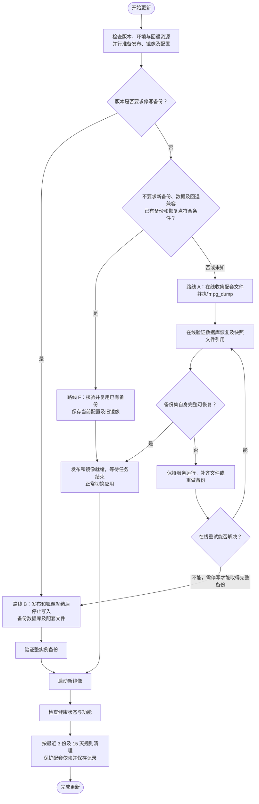

# BubblePilot 备份、升级与恢复操作手册

本文是日常部署的统一操作入口，供管理员和协助运维的 Agent 使用。首次部署、环境配置及各版本迁移要求见[部署与运维](部署与运维.md)；发布镜像与 CI 规则见[开发与发布](开发与发布.md)。本文集中维护操作顺序、停止条件与交付记录，不替代具体版本的兼容说明。

## 1. 先检查，再选择更新路线

**先判断本次变更和回退兼容性：符合条件时复用已有备份快速更新；否则先在线创建并验证备份，只有必要时才停写备份。** 管理员已接受恢复到备份时点时，可能丢失该快照之后短暂窗口内的数据；不要求备份覆盖切换前的最后一笔写入，也不把“没有生产文件冻结措施”单独作为停机理由。

| 路线 | 保障范围 | 判断结果 |
| --- | --- | --- |
| F：快速更新，复用已有备份 | 保留已验证备份集及当前配置、旧镜像；不为本次更新重新完整备份 | 数据、配置和文件的前后版本兼容，旧版可直接回退；已有完整可恢复备份，且其恢复点的潜在数据丢失在已接受范围内 |
| A：在线数据库备份＋配套文件备份 | 在线取得并验证新的数据库快照、该快照需要的文件及匹配配置密钥 | F 的兼容性或备份条件不满足、无法确认，或本版本要求更新前备份；不要求生产目录持续不变 |
| B：停应用整实例备份（例外） | 同一停止写入窗口的数据库、插件与表情文件；另存配置和密钥 | 版本明确要求停写，或在线收集／重试后仍无法取得快照所需文件版本 |

必须区分两个目标：**恢复点可以落后，但恢复点内部必须可用。** 比如 14:00 的数据库备份需要文件 A，备份内必须有对应的 A；14:02 新增消息和文件 B、14:03 切换镜像时，不要求 B 进入这份备份。正常升级继续使用原数据库和挂载，A、B 都保留；只有实际恢复到这份备份时才会丢失快照后的数据。数据库兼容时仅回退应用镜像也不会主动丢弃这些数据。

三条路线均提前准备镜像和回退配置。F 不新建完整备份，A 的备份及验证全程保持服务运行；容器切换仍可能短暂中断，不承诺零停机。B 的备份期间不重启旧应用，验证后直接启动新版；进入前说明具体原因和预计停机步骤。

不能把缺少配套文件的数据库备份称为整实例可恢复备份。本节是运维操作流程；现有脚本不自动选择路线、补齐在线文件或轮换历史备份。`backup-instance.sh` 仍是停应用脚本，不能用作在线文件收集工具。

范围是 BubblePilot 应用栈。BlueBubbles、SearXNG 自定义配置、OpenSandbox/MCP 独立栈及外部数据库需另外盘点、备份和验证；应用备份不包含网关附件原件。任务内沙箱与附件临时目录不纳入长期备份。

无论复用旧备份还是创建新备份，都只能恢复到该备份时点，不能自动保留此后的消息、配置和出站状态。停止应用期间 Webhook 是否补投取决于网关，不能承诺零消息遗漏；恢复后核对该时间段接收情况，历史补录不得盲目重放工作流。

## 2. 首次接手实例：建立受保护的运维档案

开始操作前核实并记录以下信息，后续每次部署更新它们：

- 正确的主机、Compose 项目、栈目录、服务名、实际使用的 Compose 文件与 override、环境文件及项目参数。
- 当前应用提交、镜像 digest、PostgreSQL 镜像与主版本、迁移版本、健康检查地址。
- 数据库卷、表情目录、插件目录的实际挂载；是否有额外持久化目录或外部写入者。
- 配置文件及 Secret 文件的受保护存储位置，尤其是原 `SETTINGS_ENCRYPTION_KEY`；不能在操作日志、聊天或 Git 中记录密钥值。
- 最近可恢复的备份集、校验记录、异机副本、备份占用与可用空间，以及已确定的备份周期和可接受恢复点；预留镜像、备份和临时恢复库的空间。未核实的自动备份不能当作已经存在。
- 定时提醒、空闲主动交流、在途工作流和未知投递的检查入口；维护窗口及监控方式。

仓库脚本按**脚本所在目录的上一级**寻找 Compose 栈。生产脚本必须与对应栈放置正确，不能在本地源码目录调用脚本却以为操作的是 NAS。若使用额外 Compose 参数或自定义存储路径，先确认脚本使用相同配置；标准整实例脚本固定备份 `/app/data/memes` 与 `/app/data/plugins`，自定义路径必须另行覆盖，不能漏备份。

后续示例假定已经进入正确栈目录、使用默认 Compose 文件与服务名 `app`、`postgres`，且宿主具备 `sha256sum`。逐段执行并检查结果，不能将全篇直接粘贴成无人值守脚本。

## 3. 每次升级的标准流程

### 3.1 确认范围，先准备镜像

1. 对照**实际部署的旧提交到目标提交**的全部差异，阅读 Release Notes 和[版本升级要求](部署与运维.md#升级与回滚)，确认迁移、持久化写入与删除、配置、插件合同和各镜像依赖。只更新本次涉及并授权的服务。
2. 固定目标提交，按下表选择 DEV 发布范围并启动 CI；等待期间并行完成只读环境检查、回退准备及所选备份路线的准备。发布验证与对应镜像构建均通过后记录精确 digest，不把可变 `dev` 标签作为最终部署依据。
3. 保存当前实际镜像的仓库 digest 和本地镜像 ID，以及 Compose、override、环境文件和挂载的自定义配置，限制目录访问权限。密钥另行受保护保存，并记录其备份位置，不打印内容。不要以仓库示例覆盖现有生产 Compose。
4. 按精确 digest 预拉取本次需要的镜像并核验架构；多个相互独立的镜像可并行拉取，全部成功后再切换。保持旧应用和旧 Compose 配置，不提前启动新应用或执行生产迁移。
5. 服务仍在线时准备并验证切换命令、健康检查和回退步骤；需要新备份时再准备相应文件引用校验工具。不要停机后才临时编写、传输或调试校验脚本。按第 3.7 节预览可清理备份，但先不删除；归属不明的旧目录不应拖住空间充足的本次更新。

`Publish Dev Image` 按变更影响选择范围；若共享依赖、镜像基础层或版本合同影响了多个镜像，包含所有受影响镜像，而非仅按文件路径判断：

| 范围 | 使用场景 |
| --- | --- |
| `app` | 仅应用镜像受影响 |
| `adapter` | 仅 OpenSandbox MCP 适配服务镜像受影响 |
| `app-adapter` | 应用与适配服务均受影响 |
| `all` | 需要发布沙箱 Python 运行镜像，或本次需要全部三种镜像 |

上述选择只缩小镜像构建和发布范围，不跳过现有完整验证、依赖安全检查或对应镜像的必要测试与扫描；未重建的镜像不算本轮重新扫描。正式版按其发布流程处理。已发布并验证的同一精确提交及镜像可复用，不为部署重复触发相同构建；若代码、依赖或发布条件变化则重新验证。

```sh
umask 077
BP_OP_DIR="$PWD/backups/deploy-$(date -u +%Y%m%dT%H%M%SZ)"
mkdir -p "$BP_OP_DIR"
cp compose.yaml "$BP_OP_DIR/compose.yaml"
# 使用 .env、override 或额外配置的实例，另行复制实际文件到受保护备份位置。
BP_APP_ID=$(docker compose ps -q app)
test -n "$BP_APP_ID"
BP_PREVIOUS_IMAGE_ID=$(docker inspect "$BP_APP_ID" --format '{{.Image}}')
docker inspect "$BP_APP_ID" --format '{{.Config.Image}} {{.Image}}' > "$BP_OP_DIR/previous-image.txt"
docker image inspect "$BP_PREVIOUS_IMAGE_ID" --format '{{json .RepoDigests}}' >> "$BP_OP_DIR/previous-image.txt"
docker compose config --quiet
```

`.Image` 是本地镜像 ID，不一定是仓库 manifest digest；从 `RepoDigests` 识别对应仓库摘要，并确认旧镜像仍可获取或在本地保留可引用的回退镜像。若只有可变标签、无法确认旧镜像，先补齐回退资源；防止切换后镜像清理移除回退所需内容。

将经过验证的真实 digest 填入变量，再执行拉取；下方占位符不能直接用于部署：

```sh
BP_TARGET_IMAGE='ghcr.io/shigella520/bubblepilot@sha256:<目标镜像的64位摘要>'
docker pull "$BP_TARGET_IMAGE"
```

### 3.2 检查清单与路线判定

每项记录检查时间、结果和证据位置。先检查环境、目标版本与已有备份；满足 F 的全部条件才快速更新，否则走 A 或版本要求的 B。新建在线备份的可恢复性以隔离恢复库与已收集文件的配套校验为准，不用生产目录前后是否相同代替。



图中展示正常升级主线。版本明确要求新备份时不能走 F；空间、密钥或回退资源不足，以及数据损坏、备份验证失败时，停止切换并处理；B 的验证失败同样不能继续启动新版。生产文件发生变化本身不要求改走 B，只要所用备份集自身完整即可。所有准备和可在线执行的工作都放在停机前。

#### 检查什么，以及为什么检查

| 检查对象 | 具体内容与合格证据 | 判断依据／未通过时的处理 |
| --- | --- | --- |
| 本次版本及回退兼容性 | 对照实际旧、新提交的全部迁移、数据库与文件读写、目录布局、配置、保留／清理任务、插件及外部服务合同；核对旧版能否读取新版运行后可能写入的数据和配置 | 确认兼容且可直接回退才可考虑 F；没有迁移不代表兼容。迁移或文件格式、写入语义有变化时须有对应兼容证据，未知走 A；版本要求停写则走 B。不可逆转换或清理须检查版本专属备份及恢复要求 |
| 实际挂载与额外目录 | 核对生效 Compose、override、容器 Mounts、`MEME_STORAGE_PATH`、`PLUGIN_STORAGE_PATH` 和外部写入者 | 以运行配置为准，不能只检查仓库示例；自定义持久化目录必须纳入备份和比对，脚本未覆盖时先补齐方案 |
| 表情文件 | 默认 `/app/data/memes/<storageKey>/original` 与 `preview.png`；新建备份时核对快照所需文件的相对路径、大小、SHA-256、UID/GID、权限 | 数据库 `meme_assets.storage_key` 指向文件，原图和预览均须可恢复。上传会写文件，失败清理和孤儿回收会删文件；F 复用旧备份配套证据，不要求重新遍历当前全部文件 |
| 插件文件 | 默认 `/app/data/plugins/<hash>` 是保存包内容的 JSON 文件；备份须包括快照涉及的保留版本及暂存导入文件 | `plugin_versions.hash` 和 `plugin_imports.package_hash` 关联包文件；不能只备份当前启用插件。文件内容 SHA-256 与插件逻辑包 hash 是不同校验，后者由包内文件计算，不能相互替代 |
| 现有完整备份 | 确认数据库快照、对应文件包及其依赖、配置和密钥均可取得；复核恢复、解包及引用校验记录，核对封存副本身份和可读性，记录备份时点与年龄 | F 复用的是旧快照自身完整的备份，不要求其包含快照后新增文件；若证据或副本可信性不足，重新校验或走 A。A 若复用旧文件包，仍须核对其覆盖本次 dump 的引用 |
| 数据库与文件关联 | 新建备份时，检查全部插件版本、最近 24 小时导入引用的包及表情存储键；包括软删除保留期与未结束投递仍需使用的素材；0070 之后，执行被启动清理关闭但投递仍为 unknown 且未明确关闭的表情也须保留 | A/B 须按备份的数据库快照时点在隔离恢复库核对引用，不能用活库代替或只查 `enabled`。F 复核旧备份的配套证据即可，不必重新枚举当前活库引用；发现损坏先调查修复 |
| 配置与密钥 | 本次生效的 `compose.yaml`、override、`.env`、额外配置／Secret 文件、原 `SETTINGS_ENCRYPTION_KEY`；备份位置与访问权限可核验 | 配置变化可用本次受保护副本补齐，不要求配置永远不变；数据库中的加密凭据需要匹配密钥。不能把配置和密钥值打印到日志或聊天 |
| 文件变化与备份副本保护 | 允许生产目录继续写入；所用备份副本不得被同步删除或覆盖。A/B 按新 dump 核对文件版本、哈希及权限 | 不要求冻结生产目录。缺失文件可在线补齐或重新生成快照；反复无法收集完整时才考虑 B。不得用镜像同步的删除选项破坏已收集文件 |
| 回退与空间 | 旧镜像可获取、旧配置和密钥可用、回退方案明确；按所选路线预留镜像及必要的备份、解包和临时库空间 | F 要求旧版与新版写入的数据兼容；其他情况确认配套恢复或前向修复方案。资源不足先准备或停止升级；B 不能解决空间不足、密钥丢失或旧文件已损坏 |

标准 Compose 的表情目录是命名卷 `bubblepilot-memes`，插件目录来自 `${PLUGIN_DATA_DIR:-./data/plugins}` 的绑定挂载；实际卷名会受 Compose 项目名影响。不要把数据库卷原始文件复制当成在线 `pg_dump`，也不要把聊天数据库内容未变作为在线条件：正常消息、执行、成员映射等数据库写入可以继续，`pg_dump` 负责其一致性快照，文件与数据库之间的配套关系则由上述检查保证。

临时 `.tmp-*`、Git 暂存目录也要盘点；未完成导入先结束，不能将它们混入已安装包清单。任何未识别文件先确认用途，不为获得“相同”结果而删除文件或忽略差异。网关附件原件、沙箱任务内 `/workspace` 和应用附件临时目录不因此变为本栈长期备份内容。

#### 文件为何可能在无人操作时变化

- [插件服务](../modules/plugins/plugin-service.ts)在初始化和每小时运行回收；保留 `plugin_versions` 引用以及最近 24 小时导入涉及的包。[插件存储](../modules/plugins/plugin-storage.ts)还会清理超过 24 小时的无引用包与临时项。
- [表情服务](../modules/memes/meme-service.ts)在后台处理时约每小时检查孤儿；[文件存储](../modules/memes/file-store.ts)删除超过 24 小时且不在保留集合中的目录。[数据库保留规则](../modules/memes/postgres-meme-repository.ts)包含非删除素材、删除不足 24 小时的素材以及未结束投递保护的素材。

这些后台操作可能造成在线复制竞态，但不意味着必须停机。现有插件包按 hash 存储，表情按独立存储键保存；先收集文件、再 dump、再按 dump 引用补齐并验证，可以在不冻结生产目录的情况下得到一个可用恢复点。若文件被删除或替换且没有对应版本，备份不能标记为通过：先在线重做或补齐，仍无法解决再考虑路线 B。

#### 留存配套证据

在受保护运维目录保存文件清单、哈希、权限、数据库引用校验结果及配置密钥备份位置。旧文件包可以复用，新增文件可以补充；恢复说明必须列出完整依赖关系，不能仅记一个 dump 路径。验证成功后封存备份副本；之后生产中的新增、修改或删除不使这个已验证恢复点失效，也不要求一直追赶到切换时刻。

这里不要求所有挂载目录都禁止写入：备份范围是数据库快照需要的持久化业务文件及匹配配置，不包括任务临时目录；其他独立服务仍按自身范围处理。

#### 路线 F：复用已有备份快速更新

满足下列条件时，不为本次更新重新执行 `pg_dump`、文件打包及完整恢复演练：

1. 已核对从实际运行版本到目标版本的全部变更，有证据确认新版本运行后的数据库、持久化文件、配置和相关服务合同仍可由旧版本使用；不存在版本说明要求先新建备份的变更。仅凭“没有迁移”或“看起来只是 UI”不能判定兼容。
2. 有已验证可恢复的完整备份集，能找到其数据库、对应文件及依赖、配置和匹配密钥，并能复核当时的恢复、文件引用及完整性证据；核对备份及依赖可读，身份与封存记录一致。可信不可变副本的有效校验证据可复用，不必每次重新恢复整个备份；若副本可能被替换、损坏或证据存疑，先重新校验或走 A。未重新计算哈希时不能记录为本次重新校验通过。
3. 记录备份快照时间、距预计切换的时长，以及实际恢复时可能丢失的消息、配置、文件和投递状态。**仅在该恢复点的潜在损失处于已接受范围内时复用**；若超出或无法判断，改走 A。现阶段没有约定固定的最长恢复点年龄，不能自行把 24 小时、15 天或“最近 3 份”当作允许丢失数据的上限。15 天和最近 3 份只是备份保留规则。
4. 留存当前实际配置和旧镜像，用于兼容情况下直接回退；另确认旧备份自己的配置和密钥可用于恢复旧快照。记录备份集标识、依赖及回退依据，并保护它们不被清理。
5. 按第 3.5 节等待在途任务、切换并验收。正常切换或直接回退旧镜像不恢复数据库、不覆盖现有挂载；如果之后不得不恢复旧备份，快照之后的数据仍会丢失，已发送消息也无法撤回。

F 不能代替周期备份或定期恢复演练；未核实已有自动备份及其周期时，不得假定存在。若 F 条件不满足，在线创建并验证新备份即可继续按 A 更新，不必因此直接停机。若目标版本会执行不可逆的数据转换或删除，即使没有数据库迁移，也必须在启动前按版本要求备份并准备相应恢复方案。

### 3.3 路线 B：等待在途任务，停止写入

通过执行与审计检查工作流、提醒投递、附件与沙箱任务，以及插件安装、素材上传等操作。等待在途操作结束；异常遗留“运行中”记录要单独核实，不直接批量改库或视为安全结束。

安排维护窗口，暂停管理员写操作，确认没有第二个应用副本或外部进程写相同数据库、插件和素材目录。检查与停止之间仍可能收到事件，必须依靠正常停止流程收尾，不能仅凭一次“队列为空”就强制终止。

```sh
docker compose stop app
test -z "$(docker compose ps --status running -q app)"
```

遵循现有 Compose 停止宽限，不为追求速度使用强制终止或缩短超时。确认退出情况；若发生超时强杀或投递结果未知，先记录并核对，不能自动重发。PostgreSQL 保持运行以执行逻辑备份。

### 3.4 路线 B：创建整实例备份并验证

保持旧 Compose 与镜像配置，执行[整实例脚本](../scripts/backup-instance.sh)：

```sh
BP_BACKUP_SET=$(sh scripts/backup-instance.sh "$BP_OP_DIR")
test -n "$BP_BACKUP_SET"
(cd "$BP_BACKUP_SET" && sha256sum -c SHA256SUMS)
```

脚本生成 `database.dump`、`data.tar`、`files.sha256`、`SHA256SUMS` 和恢复提示。它只在调用开始时发现应用正在运行，才在退出时自动启动旧应用；上一步已主动停止，因此本流程不会出现“备份后先启动旧应用”。单独运行脚本做日常备份则会恢复原运行状态，失败退出也可能恢复，必须检查退出码，不能以应用在线判断备份成功。

整实例脚本生成的是总校验清单，数据库恢复校验脚本要求同名 `.sha256`。先验证总清单，再生成辅助文件并执行临时库恢复：

```sh
(cd "$BP_BACKUP_SET" && sha256sum database.dump > database.dump.sha256)
sh scripts/verify-postgres-backup.sh "$BP_BACKUP_SET/database.dump"
```

该验证将备份真正恢复到随机临时数据库，检查迁移与部分关键表后删除临时库；不是生产恢复，也不是全功能验收。`pg_restore --list` 只能证明目录可读取，不能替代恢复验证。插件、表情与新增功能的数据关系还需在恢复演练中验证。另将 `data.tar` 解包到本次新建的隔离目录，核对解包后的相对路径清单和 `files.sha256`，检查文件权限；不得解包覆盖生产挂载。文件引用检查需另建隔离临时库恢复同一 dump（上述脚本已删除其临时库），按第 3.2 节保留规则与该目录核对，检查后仅删除该临时库；发现引用缺失先调查，不能仅以归档哈希通过判定整实例可恢复。

任何命令失败都停止升级，记录不完整备份，不更换镜像。不修改生产数据即可修复的问题先修复并重新备份；如放弃升级且尚未启动新版，可在确认旧配置未变后 `docker compose start app` 恢复旧应用，并验证健康。

### 3.5 三条路线汇合：切换应用，验证结果

确认所选备份路线通过、目标镜像已拉取、回退步骤和健康检查均已准备好。F/A 在保持服务在线时检查并等待在途工作流、提醒投递、附件、沙箱、插件安装和素材操作结束；B 已在停写步骤完成检查。切换阶段遵循应用正常停止宽限，出现强杀或未知投递先记录核对，不自动重发。

随后才修改生产镜像引用：使用 `BUBBLEPILOT_IMAGE` 的实例更新对应环境文件；写死 `image:` 的实例修改 Compose 的应用镜像。只修改实际生效的位置，核对 override 不会覆盖它。准备完成后连续执行切换和健康检查，避免旧应用停止后等待人工准备；不要为追求速度并排启动多个应用实例。多个服务有兼容或依赖顺序时按版本说明逐个切换，不能仅为并行而打乱顺序。

```sh
docker compose config --quiet
docker compose up -d --no-deps --wait --wait-timeout 180 app
docker compose ps
```

180 秒是示例健康等待时间，不是迁移必定完成的承诺；超时先检查状态，不能立即重复迁移或盲目回退。数据库有变更时按对应迁移说明另行安排。

验收至少包括：

- 实际运行镜像与目标 digest、提交一致；迁移完成；容器及内部、外部 `/health/ready` 正常。
- 登录与敏感解锁、BlueBubbles 连接正常；经授权的测试聊天能接收、回复，执行审计可见。
- 插件文件与表情素材可读，相关配置完整；本轮改变的功能完成针对性检查。
- 定时任务状态符合预期，没有误恢复已发送任务或重复投递。正常升级未恢复数据库时，不应被当成灾难恢复。

分别记录 CI 排队与构建、预检与回退准备、备份及验证／复用核验、镜像拉取、切换及健康恢复、功能验收与清理的起止时间。并行阶段标明重叠，计算从开始到完成的总时长时不相加重复部分，并记录阻塞或人工等待原因。应用停止至新版运行、内部健康恢复、外部不可用区间分别记录；未持续测量的外部中断标为未知。没有收到 Uptime Kuma 通知不等于没有停机，不能据此替代健康检查。

### 3.6 收尾

新建备份复制到受控异机位置后重新核对哈希；复用备份时检查并记录既有异机副本状态，不能把未验证的副本写成已完成。仅有同盘备份不能覆盖 NAS 磁盘故障。保留本次新建或复用的备份和旧镜像回退依据，验收完成前不清理旧卷、备份或镜像。验收通过后按第 3.7 节轮换，不能临时执行无差别清理来腾空间。插件升级、工具重新发现及工作流启用仅在本次授权范围内操作。

### 3.7 历史备份保留与清理

本实例采用：**最近 3 个已验证、可恢复的备份集始终保留；其他备份只有超过 15 天才可清理。** 最近 15 天内的备份全部保留，因此不是“只留 3 份”。年龄以备份记录的创建时间按 UTC 计算，严格大于 `15 × 24` 小时；不使用复制、解包或访问导致变化的目录 mtime。

以可独立恢复的一组“数据库＋文件依赖＋配置密钥＋校验记录”为一个备份集，不把同一集中的 dump、tar、校验文件或嵌套目录分别计数。

每次升级时执行；F 即使未创建新备份，也可以在验收后按以下规则清理：

1. **升级前盘点和预览**：列出备份 ID、创建时间、有效状态、大小、依赖、保留／拟删除原因。失败或未验证的新备份不能挤掉最近 3 个有效备份的名额；时间和配套关系不明确的历史目录先保留、核实，不能按名称猜测后删除。
2. **所用备份核验及升级验收通过后再清理**：保留本次复用或新建的备份、最近 3 个有效备份、所有不超过 15 天的备份、正在写入／验证的备份和显式锁定的故障回退备份。失败升级或备份验证失败不触发轮换。
3. **保护依赖**：递归保留上述备份使用的旧文件包、增量、配置及密钥副本，即便它们超过 15 天。若要回收依赖，先把所需内容并入保留备份并重新验证；未经验证不能删掉共享基础包。独立副本可释放依赖，硬链接不能被原地改写。
4. **再次确认清单后执行**：仅删除预览中已明确识别、超过 15 天、非最近 3 个且无保留依赖的完整备份集。校验目标真实路径位于本栈备份根目录，不跟随符号链接，不跨到业务挂载或其他项目。不要直接执行 `find ... -mtime +15 -delete`。
5. **留存清理记录**：在受保护运维档案保存授权依据、清理前清单、删除项、释放空间、结果及清理后保留集和依赖复核。不在普通应用日志写入备份内容或密钥。旧失败备份／临时解包目录单列处理，只有确认不再使用且符合年龄条件时清理。

这是后续已授权升级的默认轮换规则，不新增定时删除服务。现有脚本不会自动生成清理清单或执行删除；运维执行者按本节逐项核实并操作，受工具额外确认要求约束时再遵循对应要求。单纯修改这份手册不表示 NAS 历史备份已经删除。

## 4. 路线 A：在线数据库备份＋配套文件备份

**保持应用运行，先完成下列全部备份和验证，再进入镜像切换。** 不要求生产文件冻结，不要求最终生产文件清单与备份完全相同。

1. 保存本次配置和匹配密钥，盘点实际持久化路径。在新的受保护目录收集插件及表情文件，或者选取已验证的旧文件包作为基础；不要覆盖旧备份。文件复制不能带同步删除，不能复制 PostgreSQL 数据卷原始文件冒充逻辑备份。
2. 调用[数据库备份脚本](../scripts/backup-postgres.sh)，记录 dump 开始、结束时间。以数据库快照而非切换时间为恢复目标。
3. 在隔离临时库恢复 dump，从**恢复库**枚举文件引用，按引用从已经收集的副本或生产目录补齐；复制后的副本校验成功才算覆盖。允许备份中有快照未引用的额外文件，恢复时优先只还原快照需要的文件；不执行文件内的内容。
4. 验证插件逻辑包 hash、表情原图与数据库 hash、预览可读性、路径及权限；对完整配套文件生成校验清单，封存副本并记录文件包依赖。24 小时保留规则以 dump 快照为准，不能用验证当天的 `now()` 缩小需保留集合；无法确定精确快照时间时用 dump 开始时间保守计算。
5. 未通过时保持旧应用在线，尝试补齐或重做一份新的数据库和配套文件备份。不混用不匹配的版本，也不无限重试追赶写入；若确认必须停写才能收集完整，说明原因后转路线 B。备份集通过后无需因生产继续写入再重做。

```sh
BP_DB_BACKUP=$(sh scripts/backup-postgres.sh "$BP_OP_DIR")
sh scripts/verify-postgres-backup.sh "$BP_DB_BACKUP"
```

现有恢复校验脚本会删除自己的临时库，且不检查文件引用；文件关联核对仍需准备独立校验工具和隔离恢复库。工具必须在停机前准备好；若自行整合到一次恢复中，应保留同等的关键表、迁移和文件验证证据，避免为了流程形式重复恢复数据库。临时库不得启动应用或连接生产出站。

如果 dump 所需文件已全部在旧备份中，可直接配套使用，不必重新打包全部文件。已有文件包的完整校验证据可按明确的不可变备份标识复用；本次仍要核对 dump 的引用，不能用当前活库查询替代。需补齐时生成新的包或有明确依赖清单的补充包，并按第 3.7 节保护共享依赖。

通过后按第 3.5 节等待在途任务、切换并验证健康。记录 dump 开始／结束到切换的间隔；若操作中断很久或配置、密钥发生不匹配变化，重新在线备份，不把过时快照描述成“短暂窗口”。

正常更新不恢复数据库或覆盖挂载，快照后新增的数据继续保留。只有实际恢复备份时才舍弃之后的数据，且可能包括备份后已经发送的提醒；恢复时仍须核对投递、暂停调度，不自动重发。仅回退兼容镜像与恢复备份是两种操作，不要为小 UI 回退默认恢复数据库。

## 5. 失败处理与恢复

数据库迁移只前向执行，切回镜像不会撤销迁移；不要手工改写迁移历史。

| 失败阶段 | 操作 |
| --- | --- |
| 拉镜像失败，尚未停机 | 保持旧服务；排查网络、代理、仓库认证，不进入停机阶段 |
| 备份或验证失败，尚未启动新版 | 停止切换；修复后重做，或恢复旧配置并启动旧应用 |
| 新版已启动或迁移可能执行 | 停止进一步写入，查明迁移状态；不能假定启动失败就没改数据库 |
| 已确认数据库与旧版兼容 | 根据版本说明恢复旧镜像和配置，再验证；保留失败现场 |
| 不兼容或无法确定 | 优先评估前向修复；需要恢复则按配套恢复流程执行，不能只换镜像 |

恢复会舍弃备份后的数据，必须明确恢复时间点、受影响范围和授权。以下是必须执行的检查顺序，具体数据库与卷操作需根据目标实例制定命令，不提供可误覆盖生产卷的一键删除命令：

1. 停止所有相关应用写入，保留故障现场的数据库与文件副本、配置和诊断信息，记录备份后已发生的投递。
2. 验证目标备份集总哈希、配套配置与原密钥，准备兼容 PostgreSQL 和旧应用镜像。
3. 将数据库恢复到**空数据库**，不能覆盖或叠加到仍保留恢复标记的生产库；优先在隔离目标完成恢复再切换。
4. 将与所选数据库快照配套的 `data.tar`（路线 A 按其配套文件包及依赖清单）恢复到干净的插件与表情目标目录，不能混入新版遗留文件；核对路径清单、`files.sha256`、UID、权限和挂载。
5. 恢复配套配置与密钥，启动对应应用并检查健康、迁移、凭据解密、文件和业务数据。隔离演练不得连接生产 Webhook 或启用真实出站。
6. 仓库备份排除了 `scheduled_task_restore_guard` 数据。恢复启动后确认提醒调度已暂停，管理员核对实际投递，处置已发送或不确定的任务后，再敏感解锁恢复调度。未知发送不自动重试；其他可能出站的恢复任务也要核对。
7. 第三方快照若包含恢复标记，必须在启动前按[定时提醒恢复规则](部署与运维.md#定时提醒升级与恢复)设置暂停保护，不能依赖自动识别。

数据库恢复验证、文件校验和实际收发验证是不同层级，必须分别记录。定期在隔离环境演练数据库＋文件＋配置完整恢复；不能把“备份命令返回成功”当作已验证业务可用。

## 6. 每次操作的记录模板

记录保存在受控运维档案中，仓库只放虚构模板，不提交真实导出、凭据或聊天正文。

```text
操作时间、操作者、授权范围：
主机/栈/实际 Compose 配置位置：
变更范围、发布验证记录：
旧提交/镜像 digest → 新提交/镜像 digest：
迁移前后版本、数据库兼容性：
检查项逐项结论（通过／不通过／未知）、检查时间与证据位置：
备份路线 F/A/B、兼容性证据、选择原因或切换路线原因：
本次新建或复用的备份集 ID、数据库快照时间及年龄、允许丢失的数据窗口：
数据库/文件/配置备份及依赖、密钥保管位置（不填密钥值）：
实际持久化路径与挂载、全部文件写入者：
旧备份恢复、解包、文件引用和完整性证据；新建备份的核验结果：
新建备份时的 dump 开始／结束、快照引用与配套文件复核结果；复用时标明未重新执行：
备份副本封存及配套依赖（不要求生产文件冻结）：
总哈希校验、临时库恢复、文件恢复演练结果及证据时间（复用须注明）：
在途任务及未知投递处理：
CI、预检、备份、拉镜像、切换、验收和清理的各阶段耗时及重叠、等待原因：
停止/启动时间、健康恢复时间、实际外部中断（未测则注明）：
内部/外部健康、测试聊天、本轮功能验收结果：
备份后新增数据风险、回退方法与保留资源：
异机副本位置及校验结果：
历史备份清理预览、保留及依赖保护、执行结果与释放空间：
未完成项、是否需要管理员后续操作：
```

汇报中区分“已执行”“仅检查”“未验证”；发生流程偏离时列明原因和影响，不事后将缺失的备份或验证当作已完成。
