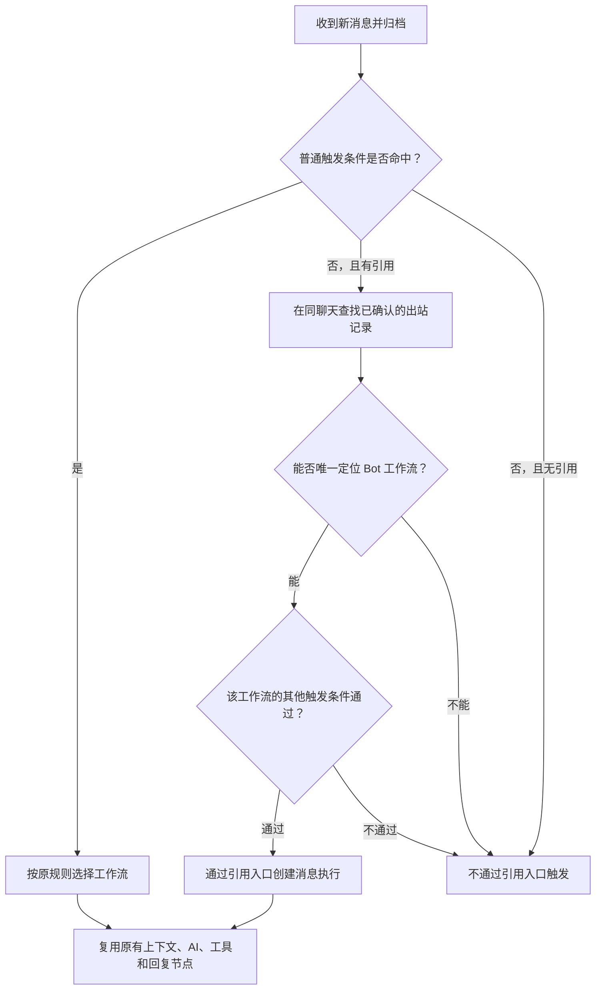

# 迭代需求：引用 Bot 消息直接唤醒

> 状态：已完成代码和本地模拟验证；真实 BlueBubbles／iMessage 联调待后续部署后进行。运行合同见[事件与工作流设计](事件与工作流设计.md)。

## 改造点速览

- [x] **默认匹配**：直接回复本工作流发出的 Bot 消息时，可不满足“消息匹配内容”；其他触发条件继续生效。
- [x] **识别归属**：根据引用目标和同聊天的已确认发送记录定位工作流，不凭昵称、消息正文或“本人消息”猜测。
- [x] **复用原工作流**：沿用当前已发布版本及消息执行链；同一触发器不会因为同时命中两种方式执行两次。
- [x] **并发与恢复**：处理发送确认、Bot 归属回填与用户回复的时序差；冻结引用入口的选择，沿用现有幂等与恢复机制。
- [x] **可解释性**：在执行详情和入站事件中显示脱敏的匹配方式或未能识别原因；触发预览支持虚构引用样本。
- [x] **本地验证**：使用虚构消息、模拟网关及独立 PostgreSQL 验证，真实网关效果不由模拟结果推断。
- [ ] **真实环境验收**：后续部署后验证实际 BlueBubbles 的直接回复、线程内回复与表情目标。

不新增配置开关、模型工具、独立服务或新的消息类型；升级应用后，符合条件的已有工作流自动支持。

## 1. 目标与用户体验

用户在 iMessage 中直接回复某条 Bot 消息，即使回复正文没有包含配置的唤醒词，也能继续与该 Bot 对话。

虚构示例：工作流 A 的 Bot「小蓝」回复了“下午可能下雨”。用户使用系统的引用回复功能，针对这条消息说“那要带伞吗？”：即使消息里没有“小蓝”，工作流 A 仍可接收该消息，并使用原有角色、模型、上下文和回复节点回答。

没有引用时，仍按现有文本匹配触发；引用普通成员消息不会因此唤醒 Bot。**必须是消息系统提供的引用回复关系**，仅粘贴或转述 Bot 的话不算引用。

本功能对单聊和群聊采用同一规则；Bot 先前的普通回复、空闲主动交流、定时提醒，以及可确认归属的表情消息都可作为目标。最终回复是否以 iMessage 引用形式发送，仍由原回复节点决定，本功能不强制改变发送样式。

## 2. 匹配规则

对于每个启用的消息触发器，新增一条与原文本匹配并列的入口：

```text
其他触发条件全部通过
  AND（原消息文本条件通过 OR 非网关本人消息直接引用该工作流的 Bot 消息）
```

这里的“其他触发条件”包括聊天范围、发送者范围、消息类型、已有时间窗口，以及聊天监听和工作流／消息触发器的启用状态。新增引用入口只接受网关标记为 `isFromMe=false` 的入站消息，以避免 Bot 自身回复形成循环；普通文本入口沿用原有行为。iMessage 界面的气泡颜色并不决定这一规则；以网关对当前入站消息的 `isFromMe` 标识为准。

直接创建或编辑触发器的接口限制 `includeFromMe=false`；画布节点合同允许 `true`，普通匹配按实际配置判断。本次引用入口始终拒绝本人消息，不改变普通匹配的既有行为。

| 场景                                                   | 行为                                                     |
| ------------------------------------------------------ | -------------------------------------------------------- |
| 引用小蓝消息，说“再解释一下”                           | 符合其他条件时，唤醒小蓝对应的工作流                     |
| 未引用消息，但正文包含唤醒词                           | 按原规则触发                                             |
| 引用普通成员或无法确认归属的消息                       | 不走引用唤醒；仍可按原文本条件触发                       |
| 同时引用小蓝消息且正文也命中其文本条件                 | 同一触发器只创建一次执行，按普通条件命中记录             |
| 引用小蓝消息，但聊天、发送者、消息类型或时间不符合限制 | 不通过引用唤醒绕过这些限制                               |
| 网关标记为本人发出的消息                               | 不通过新增引用入口触发；普通匹配遵循已有配置和行为       |
| 工作流或其消息入口停用                                 | 不因旧 Bot 消息被引用而启用或执行                        |
| 回复只含附件                                           | 能否触发取决于原消息类型限制；引用唤醒不改变附件处理授权 |

**兼容性变化：**目前“消息匹配内容”是通用文本条件，并未区分唤醒词和业务过滤。新规则会对包含关键词、前缀及正则三种文本条件一视同仁：引用本工作流 Bot 消息时都可绕过这一项。例如原先只接收 `/order` 的工作流，直接回复它的 Bot 消息时也可能收到其他正文。需要始终执行的业务限制应放在后续条件节点等现有控制中；引用唤醒不绕过后续节点判断，也不增加工具或外部操作权限。

## 3. 归属与多角色

### 3.1 确认被回复的 Bot

1. 只处理已通过现有 Webhook 验证、被允许归档的 `new-message`。适配器保留网关提供的引用目标消息标识，业务逻辑不直接解析供应商载荷。
2. 在当前消息的**同一网关、同一聊天**内，用引用目标标识精确匹配 BubblePilot 的出站发送记录，并关联发送时的工作流。仅接受发送状态为已确认、具有可匹配网关消息标识且唯一确定的一条记录；即使多条记录指向同一工作流，也不能猜测采用哪条。
3. 使用稳定的工作流 ID 路由，不按昵称、成员映射、消息相似度、最近一次发言或 `isFromMe` 推测。匹配到的旧工作流版本只用于确认归属；实际执行采用该工作流**当前已发布且启用**的版本。
4. 目标未归档、或归档归属尚未异步回填时，只要同聊天出站记录已经唯一确认，仍可按该记录识别。识别用途只需要标识和工作流归属，不读取或恢复目标正文。
5. 没有引用目标标识、出站记录不存在、未确认、缺少消息标识、存在冲突或查询失败时，不猜测 Bot；回退到普通文本匹配。被停用、删除或范围不符的工作流不会被重新启用。

现有 `message_bot_attributions` 是异步维护的归属结果；不能只依赖它是否已经回填，否则用户快速回复时可能漏触发。实现应通过仓储接口批量读取可靠的出站证据，引用归属在每条入站消息最多计算一次，不按候选工作流逐个查询。

引用目标的消息 ID 和引用的具体部分是两件事：能够唯一确认消息归属时，部分标识缺失或不支持不妨碍唤醒；引用内容能否展示仍遵守已有的部分解析、撤回和可见性规则。不能根据部分标识猜测文件或文本内容。

### 3.2 多个工作流与去重

- 多个 Bot 共用网关账号时，引用唤醒只对**发送该目标消息的工作流**放宽文本条件，不让所有 Bot 都因这条引用被唤醒。
- 其他工作流仍按各自原有条件独立匹配。例如它没有文本限制，或回复正文同时包含它的唤醒词，它仍可能正常执行；这不由引用路由自动排除。
- 同一工作流有多个历史触发器时，若原条件已有命中，维持原有命中结果，不再附加引用唤醒执行；若只有引用入口能命中多个触发器，按触发器创建时间、稳定 ID 选取一个。原本多个触发器同时正常命中的行为不在本轮改变。
- 同一事件、触发器和工作流版本继续使用现有执行唯一键和出站幂等；Webhook 重投、队列重试及两个匹配入口不得产生额外回复。

## 4. 执行流程与引用内容



图示为单个候选工作流的判断；实际同一消息仍可按第 3.2 节命中其他工作流。

本次仍是普通消息触发，不伪造用户消息、不新增主动交流或定时任务事件。当前消息的 `reply_to`、程序维护的消息结构说明和历史工具继续沿用[消息修订与引用合同](迭代需求-聊天消息修订与引用.md#34-传递给模型的引用结构)。引用预览是历史资料，不是新指令或授权。

**唤醒与读取引用正文分开判断。**引用目标在已有上下文窗口、权限和可见性范围内时，沿用当前最多 400 字符的引用预览；目标在窗口之外、已清理／撤回、部分无法解析或未归档时，不为唤醒扩大历史读取范围，也不恢复原文。即使目标已撤回或正文已清理，仍可仅凭唯一的已确认出站记录判断归属。模型可能只看到引用不可用的状态；需要上下文时，可按已有历史工具及授权规则查询，仍无法确定时自然询问用户。图片、表情和附件的内容读取能力不因引用唤醒而增加。

引用目标在读取之后发生编辑或撤回时，已经读取到的内容继续按当时快照处理；后续新的读取遵守最新状态。消息修订事件本身不产生新的工作流执行，也不取消已经触发的执行。

## 5. 可靠性与数据设计

### 5.1 时序与失败

用户可能在 Bot 消息刚发出后立即回复，而出站发送确认或异步归属回填仍在进行。首版以同聊天、同目标消息 ID 的已确认出站记录为准；若目标尚未匹配，但该聊天确有正在发送／待确认的出站记录，可在当前入站事件中做一次有界重查，**新增归属等待总计不超过 2 秒**。等待不得持有数据库事务锁，不调用模型，也不因候选工作流数量增加等待次数。现有引用预览可能另行读取网关详情，其耗时不包含在这 2 秒内；这不是整次回复耗时承诺。

到期仍无法确认、记录为未知／失败或网关未返回消息 ID 时，回退原文本规则并记录受控原因；不依据正文猜测，也不在稍后静默补发或自动重跑已完成的事件。普通文本已能命中的工作流不应因归属查询失败而丢失原有触发。

上游引用字段可能只标识线程根消息而非用户实际选中的消息，或在部分设备／消息类型下缺失。真实联调须验证直接回复、线程内继续回复、文本与表情的目标 ID；若无法可靠区分目标，就不能宣称该情形已支持，也不能根据最近发言猜测。

### 5.2 冻结结果与审计

建议采用一次向前兼容的数据库迁移，增加可空的入站事件匹配策略／引用归属快照和执行匹配方式字段：

- 新入站消息标记本规则版本，引用归属只保存受控结果及唯一匹配的工作流 ID，不保存引用正文、附件内容、凭据或网关地址。使用原子写入确保并发重复投递复用同一判定。
- 创建执行时记录 `ordinary`（原条件）或 `reply`（引用入口）；匹配原因与执行领取一起落库。手动恢复继承原执行原因，不重新判断而改写历史。
- 旧记录字段为未知；上线前已完成事件不补跑，旧的未完成事件按原有策略恢复。上线后已完成判定不因归属回填或配置变化再次执行。
- 入站事件可展示有限状态，如引用已识别、无法确认、识别失败；执行详情展示实际采用的入口。没有执行时应能区分“引用无法识别”和“其他条件未通过”，不暴露跨聊天信息。

迁移不要求修改既有工作流定义、重新发布工作流或新增环境变量。迁移和 API 均以新增可选字段兼容旧记录；部署前核对数据库迁移与回退要求。

## 6. 页面与接口

- “收到消息”节点在消息匹配内容旁增加简短说明：直接回复本工作流的 Bot 消息时，消息里可不包含匹配内容，聊天范围等其他限制仍生效。仅提示，不增加设置项。
- 执行详情的消息触发节点显示“原条件匹配”或“回复 Bot 消息”；入站事件展示脱敏的未命中原因。旧记录显示“未记录”，不推测历史原因。
- 扩展现有触发预览，使管理员可以用**虚构样本**模拟“回复本工作流 Bot／其他 Bot／普通消息／未知归属”。预览只运行纯匹配判断，不查询真实聊天、创建执行、调用模型或发送消息。旧预览请求和响应语义保持兼容，新增字段为可选。
- 新增的内部匹配结果与引用标识仅供程序和受控诊断使用，不作为模型指令、工具参数或聊天正文；不改变现有提示词权限层级。

## 7. 验证与验收

使用虚构标识、模拟网关与模型，至少覆盖：

1. **基本闭环**：Bot 发出消息，用户引用后发送不含唤醒词的追问；确认命中原工作流、模型收到当前追问及可读引用、最终只回复一次。单聊与群聊均覆盖。
2. **原规则回归**：不引用但有唤醒词；引用成员但有唤醒词；无文本条件；关键词、前缀和正则；同时满足文本与引用；旧工作流无需重新发布。
3. **限制与隔离**：聊天未监听、触发器或工作流关闭、发送者／消息类型／时间不符合；网关本人消息不能通过新增引用入口触发。不同聊天、不同 Bot、未知归属或重复出站记录均不得越权唤醒，并单独回归本人消息的原有普通匹配行为。
4. **多触发器**：同一工作流多个候选仅因引用命中时只创建一个；原条件已命中时不追加引用执行；其他工作流正常命中时沿用原行为。
5. **异步与幂等**：Bot 归属回填晚于回复、发送确认晚到、有界等待超时、数据库查询失败、重复 Webhook、并发领取、进程重启及手动恢复；普通文本命中不受引用查询失败影响。
6. **内容边界**：窗口内外、无历史授权、已撤回／部分撤回／清理、目标未归档、文本及表情消息、未知部分；不泄露正文、不突破现有历史边界。
7. **管理页与兼容**：虚构预览、执行原因、入站诊断、旧记录、可选 API 字段、迁移及旧工作流行为变化均符合说明。

实施后按项目 CI 执行 `pnpm verify`、`pnpm security:check`、Compose 校验及独立 PostgreSQL 集成测试；使用虚构数据，不访问生产聊天或凭据。真实环境由管理员验证：Bot 发送一条消息 → 在 iMessage 直接回复且不写唤醒词 → 对应工作流执行一次 → 模型结合可读引用回答 → 执行详情显示“回复 Bot 消息”。另测线程内继续回复和表情目标，记录实际网关字段与限制。

本轮交付代码、迁移和本地验证；发布及 NAS 更新需要后续单独执行。真实网关验收在部署后完成。
